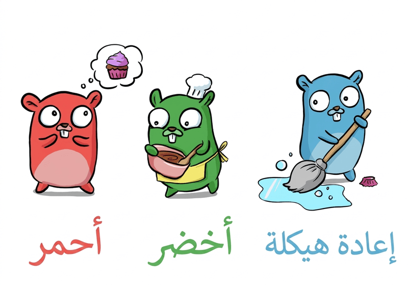

# تعلّم غو بالاختبارات

  

[رسم دينيس](https://deniseyu.io/)

> **شكر وتقدير:** هذا الكتاب في أصله من تأليف الكاتب Chris James، الذي نشره مجاناً بالإنجليزية بعنوان [Learn Go with Tests](https://quii.gitbook.io/learn-go-with-tests)، وجعل مصدره مفتوحاً على [GitHub](https://github.com/quii/learn-go-with-tests). كل ما في هذا الكتاب من أفكار وشروح وأمثلة هو من عمله، ولم يكن لي فيه إلا نقله إلى العربية. أتوجه إليه بالشكر على هذا العمل القيّم، وعلى ترحيبه بترجمته، راجياً أن ينفع قرّاء العربية كما نفع غيرهم. وتُنشر هذه الترجمة بموجب رخصة MIT نفسها التي يُنشر بها الأصل.

## ادعمني

أفخر بتقديم هذا المصدر مجاناً، لكن إن أردت أن تعبّر عن تقديرك فيمكنك أن:

* [تغرّد لي على @quii](https://twitter.com/quii)
* [تتابعني على Mastodon](https://mastodon.cloud/@quii)
* [تشتري لي فنجان قهوة](https://www.buymeacoffee.com/quii)
* [ترعاني على GitHub](https://github.com/sponsors/quii)

## تعلّم التطوير المقاد بالاختبارات (test-driven development) مع غو

* استكشف لغة غو (Go) بكتابة الاختبارات (tests)
* **اكتسب أساساً متيناً في `TDD`**. لغة غو مناسبة لتعلّم `TDD` لأنها لغة بسيطة التعلّم، والاختبار مدمج فيها
* كن واثقاً من أنك ستستطيع البدء بكتابة أنظمة (systems) متينة ومختبَرة جيداً بلغة غو

الترجمات:

* [中文](https://studygolang.gitbook.io/learn-go-with-tests)
* [Português](https://larien.gitbook.io/aprenda-go-com-testes/)
* [日本語](https://andmorefine.gitbook.io/learn-go-with-tests/)
* [Français](https://goosegeesejeez.gitbook.io/apprendre-go-par-les-tests)
* [한국어](https://miryang.gitbook.io/learn-go-with-tests/)
* [Türkçe](https://halilkocaoz.gitbook.io/go-programlama-dilini-ogren/)
* [فارسی](https://go-yaad-begir.gitbook.io/go-ba-test/)
* [Nederlands](https://bobkosse.gitbook.io/leer-go-met-tests/)
* [Tiếng Việt](https://sons-organization-15.gitbook.io/learn-go-with-tests)
* [Русский](https://eda-1.gitbook.io/lgwt/)

## الخلفية

لديّ بعض الخبرة في تعريف فرق التطوير بلغة غو، وجرّبت أساليب مختلفة لتحويل فريق من أشخاص لديهم فضول تجاه غو إلى كتّاب فعّالين جداً لأنظمة مكتوبة بها.

### ما لم ينجح

#### اقرأ _الكتاب_

من الأساليب التي جرّبناها أن نأخذ [الكتاب الأزرق](https://www.amazon.co.uk/Programming-Language-Addison-Wesley-Professional-Computing/dp/0134190440) ونناقش كل أسبوع الفصل التالي مع تمارينه.

أحب هذا الكتاب، لكنه يتطلب قدراً كبيراً من الالتزام. فهو مفصّل جداً في شرح المفاهيم، وهذا رائع بلا شك، لكنه يعني أن التقدّم بطيء ومنتظم، وهذا لا يناسب الجميع.

لاحظت أنه في حين كان عدد قليل من الناس يقرؤون الفصل X ويحلّون التمارين، فإن كثيرين لم يفعلوا.

#### حلّ بعض المسائل

تمارين الكاتا (katas) ممتعة، لكن نطاقها محدود عادةً حين يتعلق الأمر بتعلّم لغة؛ فمن غير المرجّح أن تستعمل `goroutines` لحل تمرين كاتا.

ومن المشكلات الأخرى تفاوت مستويات الحماس. فبعض الناس يتعلّمون من اللغة أكثر بكثير من غيرهم، وحين يعرضون ما أنجزوه ينتهي بهم الأمر إلى إرباك الآخرين بميزات (features) لا يعرفونها.

وهكذا يصبح التعلّم في النهاية _غير منظّم_ و_مرتجلاً_ إلى حد بعيد.

### ما نجح

كان الأسلوب الأكثر فعالية بفارق كبير هو التعريف التدريجي بأساسيات اللغة عبر قراءة موقع [go by example](https://gobyexample.com/)، واستكشافها بالأمثلة، ومناقشتها معاً كمجموعة. كان هذا أسلوباً أكثر تفاعلاً من «اقرأ الفصل X واجباً منزلياً».

ومع الوقت اكتسب الفريق أساساً متيناً في _قواعد_ اللغة، فصار بإمكاننا البدء ببناء الأنظمة.

يبدو لي هذا شبيهاً بالتمرّن على السلالم الموسيقية عند محاولة تعلّم الغيتار.

لا يهم مدى اعتقادك بأنك فنان، فمن غير المرجّح أن تكتب موسيقى جيدة دون أن تفهم الأساسيات وتتمرّن على التقنيات.

### ما ينجح معي

عندما أتعلّم _أنا_ لغة برمجة (programming language) جديدة، أبدأ عادةً بالعبث في بيئة `REPL`، لكنني في النهاية أحتاج إلى مزيد من التنظيم.

ما أحب فعله هو استكشاف المفاهيم ثم ترسيخ الأفكار بالاختبارات. فالاختبارات تتحقق من أن الشيفرة (code) التي أكتبها صحيحة، وتوثّق الميزة التي تعلّمتها.

سأجمع تجربتي في التعلّم مع مجموعة وأسلوبي الشخصي، وأحاول أن أصنع شيئاً أرجو أن يكون مفيداً لفرق أخرى: تعلّم الأساسيات بكتابة اختبارات صغيرة، كي تستطيع بعدها أن توظّف مهاراتك الحالية في تصميم البرمجيات (software design) وتطلق أنظمة رائعة.

## لمن هذا الكتاب

* للأشخاص المهتمين بتعلّم غو
* للأشخاص الذين يعرفون شيئاً من غو لكنهم يريدون استكشاف الاختبار أكثر

## ما ستحتاج إليه

* حاسوب!
* [لغة غو مثبّتة](https://golang.org/)
* محرر نصوص (text editor)
* بعض الخبرة في البرمجة، وفهم مفاهيم مثل `if` والمتغيرات (variables) والدوال (functions) وغيرها
* ارتياح في استعمال الطرفية (terminal)

## التغذية الراجعة (Feedback)

* افتح `issues` أو أرسل طلبات سحب (pull requests) [هنا](https://github.com/quii/learn-go-with-tests)، أو [غرّد لي على @quii](https://twitter.com/quii)

[رخصة MIT](LICENSE.md)
