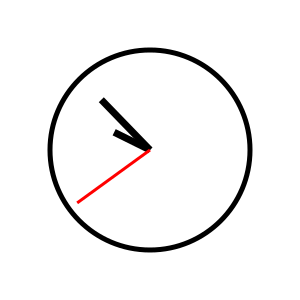
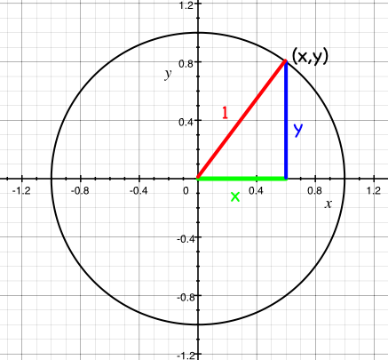

# الرياضيات

[**تجد كل شيفرة هذا الفصل هنا**](https://github.com/quii/learn-go-with-tests/tree/main/math)

رغم كل ما تملكه الحواسيب الحديثة من قدرة على إجراء عمليات حسابية ضخمة
بسرعة البرق، فإن المطور العادي نادراً ما يستعمل أي رياضيات
في عمله. لكن ليس اليوم! سنستعمل اليوم الرياضيات
لحل مشكلة _حقيقية_. وليست رياضيات مملة، بل سنستعمل
حساب المثلثات والمتجهات وكل تلك الأشياء التي
طالما قلت إنك لن تحتاج إليها أبداً بعد المدرسة الثانوية.

## المشكلة

تريد صنع صورة SVG لساعة. ليست ساعة رقمية، لا، فتلك
ستكون سهلة، بل ساعة _تناظرية_ بعقارب. لا تبحث عن أي شيء
فاخر، بل مجرد دالة (function) لطيفة تأخذ قيمة `Time` من الحزمة (package) `time`
وتُخرج صورة SVG لساعة بكل عقاربها، عقرب الساعات وعقرب الدقائق وعقرب الثواني،
مشيرة إلى الاتجاه الصحيح. ما مدى صعوبة ذلك؟

أولاً سنحتاج إلى صورة SVG لساعة نتلاعب بها. وصيغة SVG
صيغة صور رائعة للتعامل معها برمجياً، لأنها تُكتب
كسلسلة من الأشكال الموصوفة بلغة XML. فهذه الساعة:



توصف هكذا:

```xml
<?xml version="1.0" encoding="UTF-8" standalone="no"?>
<!DOCTYPE svg PUBLIC "-//W3C//DTD SVG 1.1//EN" "http://www.w3.org/Graphics/SVG/1.1/DTD/svg11.dtd">
<svg xmlns="http://www.w3.org/2000/svg"
     width="300"
     height="300"
     viewBox="0 0 300 300"
     version="2.0">

  <!-- bezel -->
  <circle cx="150" cy="150" r="100" style="fill:#fff;stroke:#000;stroke-width:5px;"/>

  <!-- hour hand -->
  <line x1="150" y1="150" x2="114.150000" y2="132.260000"
        style="fill:none;stroke:#000;stroke-width:7px;"/>

  <!-- minute hand -->
  <line x1="150" y1="150" x2="101.290000" y2="99.730000"
        style="fill:none;stroke:#000;stroke-width:7px;"/>

  <!-- second hand -->
  <line x1="150" y1="150" x2="77.190000" y2="202.900000"
        style="fill:none;stroke:#f00;stroke-width:3px;"/>
</svg>
```

إنها دائرة فيها ثلاثة خطوط، يبدأ كل منها من منتصف
الدائرة (x=150، y=150) وينتهي على مسافة ما منه.

ما سنفعله إذن هو إعادة بناء ما سبق بطريقة ما، مع تغيير الخطوط
بحيث تشير إلى الاتجاهات المناسبة لوقت معيّن.

## اختبار قبول

قبل أن نغوص في العمل، لنفكر في اختبار قبول (acceptance test).

مهلاً، أنت لا تعرف ما اختبار القبول بعد. اسمع، دعني أحاول
الشرح.

دعني أسألك: كيف يبدو الفوز؟ كيف نعرف أننا أنهينا
العمل؟ يوفر `TDD` طريقة جيدة لمعرفة متى انتهيت: حين ينجح
الاختبار. ومن الجميل أحياناً، بل في كل الأحيان تقريباً،
أن تكتب اختباراً يخبرك متى انتهيت من كتابة الميزة
القابلة للاستعمال كلها. لا مجرد اختبار يخبرك بأن دالة معيّنة
تعمل بالطريقة التي تتوقعها، بل اختبار يخبرك بأن الشيء
الذي تحاول تحقيقه كله، أي "الميزة"، قد اكتمل.

تسمى هذه الاختبارات أحياناً "اختبارات القبول"، وأحياناً
"اختبارات الميزات". والفكرة أن تكتب اختباراً عالي المستوى جداً
يصف ما تحاول تحقيقه، كأن ينقر مستخدم زراً في موقع ويب
فيرى قائمة كاملة بالبوكيمونات التي اصطادها مثلاً.
وحين نكتب ذلك الاختبار، يمكننا بعد ذلك كتابة مزيد من الاختبارات، أي اختبارات الوحدة (unit tests)،
التي تبني نحو نظام يعمل وينجح في اختبار القبول. ففي
مثالنا قد تتعلق هذه الاختبارات بعرض صفحة ويب فيها زر،
واختبار معالجات المسارات في خادم ويب، وإجراء عمليات بحث في قاعدة البيانات، وغير ذلك.
وكل هذه الأشياء ستُبنى بـ`TDD`، وكلها ستسهم في جعل
اختبار القبول الأصلي ينجح.

شيء يشبه هذه الصورة _الكلاسيكية_ لنات برايس وستيف فريمان


على أي حال، لنحاول كتابة اختبار القبول ذاك، الذي سيخبرنا
متى ننتهي.

لدينا ساعة مثال، فلنفكر في المعاملات (parameters) المهمة.

```
<line x1="150" y1="150" x2="114.150000" y2="132.260000"
        style="fill:none;stroke:#000;stroke-width:7px;"/>
```

مركز الساعة (السمتان `x1` و`y1` لهذا الخط) هو نفسه
لكل عقرب من عقارب الساعة. والأعداد التي تحتاج إلى التغير مع كل عقرب،
أي المعاملات التي تُمرَّر إلى ما يبني صورة SVG، هي السمتان `x2` و`y2`.
سنحتاج إلى X وY لكل عقرب من عقارب الساعة.

_كان بإمكاني_ التفكير في معاملات أكثر، مثل نصف قطر دائرة وجه الساعة،
وحجم صورة SVG، وألوان العقارب، وشكلها، وغير ذلك... لكن من الأفضل
أن نبدأ بحل مشكلة بسيطة ومحددة بحل بسيط ومحدد،
ثم نبدأ بإضافة المعاملات لتعميمه.

لذا سنقول إن
- مركز كل ساعة هو (150، 150)
- طول عقرب الساعات 50
- طول عقرب الدقائق 80
- طول عقرب الثواني 90.

ملاحظة عن صور SVG: نقطة الأصل، أي النقطة (0،0)، تقع في الزاوية _العلوية اليسرى_،
لا _السفلية اليسرى_ كما قد نتوقع. وسيكون من المهم تذكر
هذا حين نحدد الأعداد التي نضعها في خطوطنا.

وأخيراً، لن أقرر _كيف_ نبني صورة SVG، فيمكننا استعمال قالب
من الحزمة [`text/template`](https://golang.org/pkg/text/template/)، أو يمكننا ببساطة إرسال البايتات إلى
`bytes.Buffer` أو إلى كاتب. لكننا نعرف أننا سنحتاج إلى تلك الأعداد، فلنركز
على اختبار شيء يُنشئها.

### اكتب الاختبار أولاً

فيبدو اختباري الأول هكذا:

```go
package clockface_test

import (
	"projectpath/clockface"
	"testing"
	"time"
)

func TestSecondHandAtMidnight(t *testing.T) {
	tm := time.Date(1337, time.January, 1, 0, 0, 0, 0, time.UTC)

	want := clockface.Point{X: 150, Y: 150 - 90}
	got := clockface.SecondHand(tm)

	if got != want {
		t.Errorf("Got %v, wanted %v", got, want)
	}
}
```

المسار `projectpath` هنا مجرد عنصر نائب، فاستبدل به مسار وحدتك النمطية مضافاً إليه `/clockface` (فمثلاً إن كان ملفك `go.mod` يقول `module example.com/learning-go`، فسيكون هذا الاستيراد `"example.com/learning-go/clockface"`). وهذا ينجح لأننا نضع `clockface_test.go` في مجلده الخاص المسمى `clockface`، إلى جانب `clockface.go` (الذي سننشئه بعد قليل). فتسمية المجلد بما يطابق اسم الحزمة التي يحتويها تعني أن غو تستطيع حلّ الاستيراد دون حاجة إلى اسم بديل. أما `package clockface_test` داخل المجلد نفسه فحالة خاصة تسمح بها غو: حزمة اختبار خارجية يمكن أن تعيش إلى جانب ملفات `package clockface` في المجلد نفسه.

هل تذكر كيف ترسم صور SVG إحداثياتها من الزاوية العلوية اليسرى؟ لوضع
عقرب الثواني عند منتصف الليل، نتوقع ألا يكون قد تحرك من مركز
وجه الساعة على المحور X، أي ما زال 150، وأن يكون المحور Y هو طول
العقرب "صعوداً" من المركز؛ أي 150 ناقص 90.

### حاول تشغيل الاختبار

هذا يُظهر حالات الفشل المتوقعة المتعلقة بالدوال والأنواع الناقصة:

```
--- FAIL: TestSecondHandAtMidnight (0.00s)
./clockface_test.go:13:10: undefined: clockface.Point
./clockface_test.go:14:9: undefined: clockface.SecondHand
```

إذن نحتاج إلى `Point` حيث ينبغي أن يكون طرف عقرب الثواني، ودالة للحصول عليه.

### اكتب أقل قدر من الشيفرة لتشغيل الاختبار وتحقق من مخرجات الاختبار الفاشل

لننفّذ هذه الأنواع كي تُصرَّف الشيفرة (code)

```go
package clockface

import "time"

// A Point represents a two-dimensional Cartesian coordinate
type Point struct {
	X float64
	Y float64
}

// SecondHand is the unit vector of the second hand of an analogue clock at time `t`
// represented as a Point.
func SecondHand(t time.Time) Point {
	return Point{}
}
```

ونحصل الآن على:

```
--- FAIL: TestSecondHandAtMidnight (0.00s)
    clockface_test.go:17: Got {0 0}, wanted {150 60}
FAIL
exit status 1
FAIL	learn-go-with-tests/math/clockface	0.006s
```

### اكتب ما يكفي من الشيفرة لينجح الاختبار

حين نحصل على الفشل المتوقع، يمكننا ملء القيمة المعادة من `SecondHand`:

```go
// SecondHand is the unit vector of the second hand of an analogue clock at time `t`
// represented as a Point.
func SecondHand(t time.Time) Point {
	return Point{150, 60}
}
```

ها هو اختبار ناجح.

```
PASS
ok  	    clockface	0.006s
```

### أعد الهيكلة

لا حاجة إلى إعادة الهيكلة بعد، فالشيفرة بالكاد تكفي!

### كرر مع المتطلبات الجديدة

علينا على الأرجح القيام ببعض العمل هنا، لا يقتصر على إعادة
ساعة تشير إلى منتصف الليل في كل الأوقات...

### اكتب الاختبار أولاً

```go
func TestSecondHandAt30Seconds(t *testing.T) {
	tm := time.Date(1337, time.January, 1, 0, 0, 30, 0, time.UTC)

	want := clockface.Point{X: 150, Y: 150 + 90}
	got := clockface.SecondHand(tm)

	if got != want {
		t.Errorf("Got %v, wanted %v", got, want)
	}
}
```

الفكرة نفسها، لكن عقرب الثواني يشير الآن إلى _الأسفل_، لذا _نضيف_
الطول إلى إحداثي Y الخاص به.

هذا سيُصرَّف... لكن كيف نجعله ينجح؟

## وقت التفكير

كيف سنحل هذه المشكلة؟

في كل دقيقة يمر عقرب الثواني بالحالات الـ60 نفسها، مشيراً إلى 60
اتجاهاً مختلفاً. فحين تكون الثواني 0 يشير إلى أعلى وجه الساعة،
وحين تكون 30 ثانية يشير إلى أسفله. سهل بما يكفي.

فإن أردت أن أفكر في الاتجاه الذي يشير إليه عقرب الثواني عند،
لنقل، 37 ثانية، فسأريد الزاوية بين الساعة 12 و37/60 من محيط
الدائرة. وبالدرجات هذا هو `(360 / 60 ) * 37 = 222`، لكن الأسهل أن
نتذكر أنه `37/60` من دورة كاملة.

لكن الزاوية ليست إلا نصف القصة؛ فنحن نحتاج إلى معرفة الإحداثيين X وY
اللذين يشير إليهما طرف عقرب الثواني. كيف نحسب ذلك؟

## الرياضيات

تخيّل دائرة نصف قطرها 1 مرسومة حول نقطة الأصل، أي الإحداثي `0, 0` بالتحديد.


تسمى هذه "دائرة الوحدة" لأن... حسناً، نصف قطرها وحدة واحدة!

يتكون محيط الدائرة من نقاط على الشبكة، أي مزيد من
الإحداثيات. ويشكّل المكونان x وy لكل من هذه الإحداثيات
مثلثاً، وتره دائماً 1 (أي نصف قطر الدائرة).



يتيح لنا حساب المثلثات الآن حساب طولي X وY لكل مثلث
إن عرفنا الزاوية التي يصنعها مع نقطة الأصل. فسيكون الإحداثي X هو cos(a)،
والإحداثي Y هو sin(a)، حيث a الزاوية بين الخط
والمحور x (الموجب).

.png>)

(إن لم تصدّق هذا، [فاذهب وانظر في ويكيبيديا...](https://en.wikipedia.org/wiki/Sine#Unit_circle_definition))

ولمسة أخيرة: لأننا نريد قياس الزاوية من الساعة 12 بدلاً
من المحور X (الساعة 3)، علينا تبديل المحورين، فيصبح الآن
x = sin(a) وy = cos(a).


صرنا نعرف الآن كيف نحصل على زاوية عقرب الثواني (1/60 من الدائرة
لكل ثانية) وعلى الإحداثيين X وY. وسنحتاج إلى دالتين لكل من `sin`
و`cos`.

## الحزمة `math`

لحسن الحظ في الحزمة `math` في غو (Go) الدالتان كلتاهما، مع عقبة صغيرة علينا
استيعابها؛ فإن نظرنا إلى وصف [`math.Cos`](https://golang.org/pkg/math/#Cos):

> تعيد `Cos` جيب التمام للوسيط `x` المقدّر بالراديان.

إنها تريد الزاوية بالراديان. فما الراديان؟ بدلاً من تعريف الدورة الكاملة للدائرة بأنها 360 درجة، نعرّفها بأنها 2π راديان. وهناك أسباب وجيهة لذلك لن نخوض فيها.

والآن بعد أن قرأنا وتعلّمنا وفكّرنا قليلاً، يمكننا كتابة
اختبارنا التالي.

### اكتب الاختبار أولاً

كل هذه الرياضيات صعبة ومربكة. لست واثقاً من أنني أفهم ما
يجري، لذا لنكتب اختباراً! لا نحتاج إلى حل المشكلة كلها
دفعة واحدة، فلنبدأ بحساب الزاوية الصحيحة بالراديان لعقرب
الثواني في وقت معيّن.

سأحوّل اختبار القبول الذي كنت أعمل عليه إلى _تعليق_ ريثما
أعمل على هذه الاختبارات، فلا أريد أن يشتتني ذلك الاختبار بينما
أجعل هذا الاختبار ينجح.

### تذكير بالحزم

حالياً، اختبارات القبول لدينا في الحزمة `clockface_test`. ويمكن لاختباراتنا
أن تكون خارج الحزمة `clockface`، فما دامت أسماء ملفاتها تنتهي بـ`_test.go`
فيمكن تشغيلها.

سأكتب اختبارات الراديان هذه _داخل_ الحزمة `clockface`، فقد لا تُصدَّر
أبداً، وقد تُحذف (أو تُنقل) بعد أن أفهم ما يجري
بشكل أفضل. وسأغيّر اسم ملف اختبار القبول إلى `clockface_acceptance_test.go`،
كي أستطيع إنشاء ملف _جديد_ باسم `clockface_test` لاختبار الثواني بالراديان.

```go
package clockface

import (
	"math"
	"testing"
	"time"
)

func TestSecondsInRadians(t *testing.T) {
	thirtySeconds := time.Date(312, time.October, 28, 0, 0, 30, 0, time.UTC)
	want := math.Pi
	got := secondsInRadians(thirtySeconds)

	if want != got {
		t.Fatalf("Wanted %v radians, but got %v", want, got)
	}
}
```

نختبر هنا أن مرور 30 ثانية على الدقيقة ينبغي أن يضع
عقرب الثواني في منتصف الساعة. وهذا أول استعمال لنا
للحزمة `math`! فإن كانت الدورة الكاملة للدائرة 2π راديان،
فإننا نعرف أن نصفها ينبغي أن يكون π راديان فقط. وتوفر لنا `math.Pi`
قيمة π.

### حاول تشغيل الاختبار

```
./clockface_test.go:12:9: undefined: secondsInRadians
```

### اكتب أقل قدر من الشيفرة لتشغيل الاختبار وتحقق من مخرجات الاختبار الفاشل

```go
func secondsInRadians(t time.Time) float64 {
	return 0
}
```

```
clockface_test.go:15: Wanted 3.141592653589793 radians, but got 0
```

### اكتب ما يكفي من الشيفرة لينجح الاختبار

```go
func secondsInRadians(t time.Time) float64 {
	return math.Pi
}
```

```
PASS
ok  	clockface	0.011s
```

### أعد الهيكلة

لا شيء يحتاج إلى إعادة هيكلة بعد

### كرر مع المتطلبات الجديدة

يمكننا الآن توسيع الاختبار ليغطي بعض السيناريوهات الأخرى. سأقفز
قليلاً إلى الأمام وأعرض شيفرة اختبار أُعيدت هيكلتها بالفعل، وينبغي أن يكون واضحاً
بما يكفي كيف وصلت إلى ما أريد.

```go
func TestSecondsInRadians(t *testing.T) {
	cases := []struct {
		time  time.Time
		angle float64
	}{
		{simpleTime(0, 0, 30), math.Pi},
		{simpleTime(0, 0, 0), 0},
		{simpleTime(0, 0, 45), (math.Pi / 2) * 3},
		{simpleTime(0, 0, 7), (math.Pi / 30) * 7},
	}

	for _, c := range cases {
		t.Run(testName(c.time), func(t *testing.T) {
			got := secondsInRadians(c.time)
			if got != c.angle {
				t.Fatalf("Wanted %v radians, but got %v", c.angle, got)
			}
		})
	}
}
```

أضفت دالتين مساعدتين لجعل كتابة هذا الاختبار الجدولي
أقل مللاً قليلاً. تحوّل `testName` الوقت إلى صيغة الساعة
الرقمية (HH:MM:SS)، وتبني `simpleTime` قيمة `time.Time` باستعمال
الأجزاء التي تهمنا فعلاً فقط (مرة أخرى: الساعات والدقائق والثواني). وإليك
الدالتين:

```go
func simpleTime(hours, minutes, seconds int) time.Time {
	return time.Date(312, time.October, 28, hours, minutes, seconds, 0, time.UTC)
}

func testName(t time.Time) string {
	return t.Format("15:04:05")
}
```

ينبغي أن تساعد هاتان الدالتان على جعل هذه الاختبارات (والاختبارات المستقبلية) أسهل
قليلاً في الكتابة والصيانة.

وهذا يعطينا مخرجات اختبار جميلة:

```
clockface_test.go:24: Wanted 0 radians, but got 3.141592653589793

clockface_test.go:24: Wanted 4.71238898038469 radians, but got 3.141592653589793
```

حان وقت تنفيذ كل تلك الرياضيات التي تحدثنا عنها أعلاه:

```go
func secondsInRadians(t time.Time) float64 {
	return float64(t.Second()) * (math.Pi / 30)
}
```

الثانية الواحدة تساوي (2π / 60) راديان... نختصر الـ2 فنحصل على π/30 راديان.
ونضرب ذلك في عدد الثواني (كقيمة `float64`)، فينبغي أن تنجح الآن
كل الاختبارات...


```
clockface_test.go:24: Wanted 3.141592653589793 radians, but got 3.1415926535897936
```

مهلاً، ماذا؟

### الأعداد العشرية فظيعة

حساب الفاصلة العائمة [معروف بعدم دقته](https://0.30000000000000004.com/). فالحواسيب
لا تستطيع حقاً التعامل إلا مع الأعداد الصحيحة، ومع الأعداد النسبية إلى حد ما. أما الأعداد
العشرية فتبدأ بفقدان دقتها، خصوصاً حين نضربها ونقسمها
كما نفعل في الدالة `secondsInRadians`. فبقسمة `math.Pi` على 30
ثم ضربها في 30 انتهى بنا الأمر إلى _عدد لم يعد مساوياً
لـ`math.Pi`_.

هناك طريقتان للتعامل مع هذا:

1. أن نتعايش معه
2. أن نعيد هيكلة دالتنا بإعادة ترتيب المعادلة

قد لا يبدو الخيار (1) جذاباً، لكنه كثيراً ما يكون الطريقة الوحيدة لجعل
مقارنة المساواة بين الأعداد العشرية تعمل. فعدم الدقة بكسر متناهٍ في الصغر
لن يهم بصراحة لأغراض رسم وجه ساعة، لذا
يمكننا كتابة دالة تعرّف مساواة "قريبة بما يكفي" لزوايانا.
لكن هناك طريقة بسيطة لاستعادة الدقة: نعيد ترتيب المعادلة
بحيث لا نقسم ثم نضرب. ويمكننا فعل كل شيء
بالقسمة فقط.

فبدلاً من

```
numberOfSeconds * π / 30
```

يمكننا أن نكتب

```
π / (30 / numberOfSeconds)
```

وهما متكافئتان.

وفي غو:

```go
func secondsInRadians(t time.Time) float64 {
	return (math.Pi / (30 / (float64(t.Second()))))
}
```

وينجح الاختبار.

```
PASS
ok      clockface     0.005s
```

ينبغي أن يبدو كل شيء [شيئاً كهذا](https://github.com/quii/learn-go-with-tests/tree/main/math/v3/clockface).

### ملاحظة عن القسمة على صفر

كثيراً ما لا تحب الحواسيب القسمة على صفر، لأن اللانهاية أمر غريب بعض الشيء.

في غو، إن حاولت القسمة على صفر صراحةً فستحصل على خطأ تصريف.

```go
package main

import (
	"fmt"
)

func main() {
	fmt.Println(10.0 / 0.0) // fails to compile
}
```

ومن الواضح أن المصرِّف (compiler) لا يستطيع دائماً التنبؤ بأنك ستقسم على صفر، كما في حالة `t.Second()`

جرّب هذا

```go
func main() {
	fmt.Println(10.0 / zero())
}

func zero() float64 {
	return 0.0
}
```

سيطبع `+Inf` (اللانهاية). ويبدو أن القسمة على `+Inf` تعطي صفراً، ويمكننا رؤية ذلك بما يلي:

```go
package main

import (
	"fmt"
	"math"
)

func main() {
	fmt.Println(secondsinradians())
}

func zero() float64 {
	return 0.0
}

func secondsinradians() float64 {
	return (math.Pi / (30 / (float64(zero()))))
}
```

### كرر مع المتطلبات الجديدة

غطّينا إذن الجزء الأول هنا، فنحن نعرف الزاوية التي سيشير إليها عقرب الثواني
بالراديان. والآن علينا حساب الإحداثيات.

مرة أخرى، لنُبقِ الأمر بأبسط ما يمكن ونعمل فقط مع _دائرة
الوحدة_، أي الدائرة التي نصف قطرها 1. وهذا يعني أن طول عقاربنا كلها
سيكون واحداً، لكن من الجانب المشرق يعني أن الرياضيات ستكون سهلة
الهضم.

### اكتب الاختبار أولاً

```go
func TestSecondHandPoint(t *testing.T) {
	cases := []struct {
		time  time.Time
		point Point
	}{
		{simpleTime(0, 0, 30), Point{0, -1}},
	}

	for _, c := range cases {
		t.Run(testName(c.time), func(t *testing.T) {
			got := secondHandPoint(c.time)
			if got != c.point {
				t.Fatalf("Wanted %v Point, but got %v", c.point, got)
			}
		})
	}
}
```

### حاول تشغيل الاختبار

```
./clockface_test.go:40:11: undefined: secondHandPoint
```

### اكتب أقل قدر من الشيفرة لتشغيل الاختبار وتحقق من مخرجات الاختبار الفاشل

```go
func secondHandPoint(t time.Time) Point {
	return Point{}
}
```

```
clockface_test.go:42: Wanted {0 -1} Point, but got {0 0}
```

### اكتب ما يكفي من الشيفرة لينجح الاختبار

```go
func secondHandPoint(t time.Time) Point {
	return Point{0, -1}
}
```

```
PASS
ok  	clockface	0.007s
```

### كرر مع المتطلبات الجديدة

```go
func TestSecondHandPoint(t *testing.T) {
	cases := []struct {
		time  time.Time
		point Point
	}{
		{simpleTime(0, 0, 30), Point{0, -1}},
		{simpleTime(0, 0, 45), Point{-1, 0}},
	}

	for _, c := range cases {
		t.Run(testName(c.time), func(t *testing.T) {
			got := secondHandPoint(c.time)
			if got != c.point {
				t.Fatalf("Wanted %v Point, but got %v", c.point, got)
			}
		})
	}
}
```

### حاول تشغيل الاختبار

```
clockface_test.go:43: Wanted {-1 0} Point, but got {0 -1}
```

### اكتب ما يكفي من الشيفرة لينجح الاختبار

هل تذكر صورة دائرة الوحدة؟

.png>)

وتذكّر أيضاً أننا نريد قياس الزاوية من الساعة 12، أي من المحور Y، بدلاً من المحور X الذي كان سيجعلنا نقيس الزاوية بين عقرب الثواني والساعة 3.


نريد الآن المعادلة التي تُنتج X وY. لنكتبها للثواني:

```go
func secondHandPoint(t time.Time) Point {
	angle := secondsInRadians(t)
	x := math.Sin(angle)
	y := math.Cos(angle)

	return Point{x, y}
}
```

نحصل الآن على

```
clockface_test.go:43: Wanted {0 -1} Point, but got {1.2246467991473515e-16 -1}

clockface_test.go:43: Wanted {-1 0} Point, but got {-1 -1.8369701987210272e-16}
```

مهلاً، ماذا (مرة أخرى)؟ يبدو أن لعنة الأعداد العشرية أصابتنا مجدداً، فكلا
العددين غير المتوقعين _متناهيان في الصغر_، في المنزلة العشرية السادسة عشرة.
لذا يمكننا مرة أخرى إما محاولة زيادة الدقة، أو أن نقول ببساطة
إنهما متساويان تقريباً ونمضي في حياتنا.

من خيارات زيادة دقة هذه الزوايا استعمال النوع النسبي
`Rat` من الحزمة `math/big`. لكن بما أن الهدف رسم
صورة SVG لا الهبوط على القمر، فأظن أننا نستطيع التعايش مع قليل من
عدم الدقة.

```go
func TestSecondHandPoint(t *testing.T) {
	cases := []struct {
		time  time.Time
		point Point
	}{
		{simpleTime(0, 0, 30), Point{0, -1}},
		{simpleTime(0, 0, 45), Point{-1, 0}},
	}

	for _, c := range cases {
		t.Run(testName(c.time), func(t *testing.T) {
			got := secondHandPoint(c.time)
			if !roughlyEqualPoint(got, c.point) {
				t.Fatalf("Wanted %v Point, but got %v", c.point, got)
			}
		})
	}
}

func roughlyEqualFloat64(a, b float64) bool {
	const equalityThreshold = 1e-7
	return math.Abs(a-b) < equalityThreshold
}

func roughlyEqualPoint(a, b Point) bool {
	return roughlyEqualFloat64(a.X, b.X) &&
		roughlyEqualFloat64(a.Y, b.Y)
}
```

عرّفنا دالتين لتعريف المساواة التقريبية بين قيمتين
من `Points`، وستعملان إن كان الفرق بين عنصري X وY في كل منهما ضمن 0.0000001.
وهذا ما زال دقيقاً جداً.

ونحصل الآن على:

```
PASS
ok  	clockface	0.007s
```

### أعد الهيكلة

ما زلت راضياً عن هذا تماماً.


إليك [كيف تبدو الآن](https://github.com/quii/learn-go-with-tests/tree/main/math/v4/clockface)


### كرر مع المتطلبات الجديدة

حسناً، قول _جديدة_ ليس دقيقاً تماماً، فما يمكننا فعله حقاً الآن هو جعل
اختبار القبول ذاك ينجح! لنذكّر أنفسنا كيف يبدو:


```go
func TestSecondHandAt30Seconds(t *testing.T) {
	tm := time.Date(1337, time.January, 1, 0, 0, 30, 0, time.UTC)

	want := clockface.Point{X: 150, Y: 150 + 90}
	got := clockface.SecondHand(tm)

	if got != want {
		t.Errorf("Got %v, wanted %v", got, want)
	}
}
```

### حاول تشغيل الاختبار

```
clockface_acceptance_test.go:28: Got {150 60}, wanted {150 240}
```

### اكتب ما يكفي من الشيفرة لينجح الاختبار

علينا فعل ثلاثة أشياء لتحويل متجه الوحدة إلى نقطة على صورة SVG الخاصة بنا:

1. تحجيمه إلى طول العقرب
2. قلبه حول المحور X لمراعاة أن نقطة أصل SVG في
   الزاوية العلوية اليسرى
3. إزاحته إلى الموضع الصحيح (بحيث ينطلق من نقطة أصل
   هي (150،150))

أوقات ممتعة!

```go
// SecondHand is the unit vector of the second hand of an analogue clock at time `t`
// represented as a Point.
func SecondHand(t time.Time) Point {
	p := secondHandPoint(t)
	p = Point{p.X * 90, p.Y * 90}   // scale
	p = Point{p.X, -p.Y}            // flip
	p = Point{p.X + 150, p.Y + 150} // translate
	return p
}
```

التحجيم ثم القلب ثم الإزاحة، بهذا الترتيب بالضبط. تحيا الرياضيات!

```
PASS
ok  	clockface	0.007s
```

### أعد الهيكلة

هناك بعض الأعداد السحرية هنا ينبغي استخراجها كثوابت، لذا
لنفعل ذلك

```go
const secondHandLength = 90
const clockCentreX = 150
const clockCentreY = 150

// SecondHand is the unit vector of the second hand of an analogue clock at time `t`
// represented as a Point.
func SecondHand(t time.Time) Point {
	p := secondHandPoint(t)
	p = Point{p.X * secondHandLength, p.Y * secondHandLength}
	p = Point{p.X, -p.Y}
	p = Point{p.X + clockCentreX, p.Y + clockCentreY} //translate
	return p
}
```

## ارسم الساعة

حسناً... عقرب الثواني على الأقل...

لننجز هذا، فلا شيء أسوأ من عدم تقديم قيمة ما
وهي جاهزة تنتظر أن تخرج إلى العالم لتبهر
الناس. لنرسم عقرب الثواني!

سنضع مجلداً جديداً تحت مجلد الحزمة الرئيسية `clockface`،
ونسميه (بشكل محيّر) `clockface`. وسنضع فيه الحزمة `main`
التي ستُنشئ الملف التنفيذي الذي يبني صورة SVG المطلوبة:

```
|-- clockface
|       |-- main.go
|-- clockface.go
|-- clockface_acceptance_test.go
|-- clockface_test.go
```

داخل `main.go` ستبدأ بهذه الشيفرة، لكن غيّر سطر الاستيراد الخاص بالحزمة
`clockface` ليشير إلى نسختك الخاصة:

```go
package main

import (
	"fmt"
	"io"
	"os"
	"time"

	"learn-go-with-tests/math/clockface" // REPLACE THIS!
)

func main() {
	t := time.Now()
	sh := clockface.SecondHand(t)
	io.WriteString(os.Stdout, svgStart)
	io.WriteString(os.Stdout, bezel)
	io.WriteString(os.Stdout, secondHandTag(sh))
	io.WriteString(os.Stdout, svgEnd)
}

func secondHandTag(p clockface.Point) string {
	return fmt.Sprintf(`<line x1="150" y1="150" x2="%f" y2="%f" style="fill:none;stroke:#f00;stroke-width:3px;"/>`, p.X, p.Y)
}

const svgStart = `<?xml version="1.0" encoding="UTF-8" standalone="no"?>
<!DOCTYPE svg PUBLIC "-//W3C//DTD SVG 1.1//EN" "http://www.w3.org/Graphics/SVG/1.1/DTD/svg11.dtd">
<svg xmlns="http://www.w3.org/2000/svg"
     width="100%"
     height="100%"
     viewBox="0 0 300 300"
     version="2.0">`

const bezel = `<circle cx="150" cy="150" r="100" style="fill:#fff;stroke:#000;stroke-width:5px;"/>`

const svgEnd = `</svg>`
```

يا للهول، لست أسعى إلى الفوز بأي جوائز على جمال الشيفرة بـ_هذه_ الفوضى،
لكنها تؤدي المهمة. فهي تكتب صورة SVG إلى `os.Stdout`، سلسلة نصية
تلو الأخرى.

إن بنينا هذا

```
go build
```

وشغّلناه، مرسلين المخرجات إلى ملف

```
./clockface > clock.svg
```

فينبغي أن نرى شيئاً مثل


وهذه [هي الشيفرة](https://github.com/quii/learn-go-with-tests/tree/main/math/v6/clockface).


### أعد الهيكلة

هذه رائحتها كريهة. حسناً، ليست _كريهة_ تماماً، لكنني لست راضياً عنها.

1. الدالة `SecondHand` كلها مرتبطة _بشدة_ بصيغة SVG... دون
   أن تذكرها أو تُنتج فعلاً صورة SVG حقيقية...
2. ... وفي الوقت نفسه لا أختبر أي جزء من شيفرة SVG لدي.

نعم، أظنني أفسدت الأمر. هذا يبدو خاطئاً. لنحاول التعافي باختبار
يتمحور أكثر حول صيغة SVG نفسها.

ما خياراتنا؟ حسناً، يمكننا محاولة اختبار أن المحارف التي تتدفق
من `SVGWriter` تحتوي على أشياء تشبه وسم SVG الذي
نتوقعه لوقت معيّن. على سبيل المثال:

```go
func TestSVGWriterAtMidnight(t *testing.T) {
	tm := time.Date(1337, time.January, 1, 0, 0, 0, 0, time.UTC)

	var b strings.Builder
	clockface.SVGWriter(&b, tm)
	got := b.String()

	want := `<line x1="150" y1="150" x2="150" y2="60"`

	if !strings.Contains(got, want) {
		t.Errorf("Expected to find the second hand %v, in the SVG output %v", want, got)
	}
}
```

لكن هل هذا تحسين حقاً؟

فهو لن يظل ينجح حتى لو لم أُنتج صورة SVG صالحة فحسب (لأنه يختبر فقط
ظهور سلسلة نصية في المخرجات)، بل سيفشل أيضاً إن أجريت
أصغر تغيير غير مهم على تلك السلسلة، كأن أضيف مسافة إضافية بين
السمات مثلاً.

أكبر _رائحة_ هنا أنني أختبر هيكل بيانات، هو XML، بالنظر
إلى تمثيله كسلسلة من المحارف، أي كسلسلة نصية. وهذه _ليست أبداً_
فكرة جيدة، لأنها تُنتج مشكلات كالتي وصفتها للتو:
اختبار هش جداً وغير حساس بما يكفي في آن واحد. اختبار يختبر
الشيء الخطأ!

لذا فالحل الوحيد هو اختبار المخرجات _بوصفها XML_. ولفعل ذلك علينا
تحليلها.

## تحليل XML

الحزمة [`encoding/xml`](https://pkg.go.dev/encoding/xml) هي حزمة غو التي تتولى كل ما يتعلق
بتحليل XML البسيط.

تأخذ الدالة [`xml.Unmarshal`](https://pkg.go.dev/encoding/xml#Unmarshal)
قيمة `[]byte` من بيانات XML، ومؤشراً (pointer) إلى بنية (struct) تُفكّ البيانات
فيها.

سنحتاج إذن إلى بنية نفكّ فيها XML. يمكننا قضاء بعض الوقت
في معرفة الأسماء الصحيحة لكل العقد والسمات، وكيفية
كتابة البنية الصحيحة، لكن لحسن الحظ كتب أحدهم
[`zek`](https://github.com/miku/zek)، وهو برنامج يؤتمت كل ذلك
العمل الشاق عنا. والأفضل من ذلك أن هناك نسخة على الإنترنت على
[https://xml-to-go.github.io/](https://xml-to-go.github.io/). فقط
الصق صورة SVG الموجودة في أعلى الملف في أحد المربعين، وفجأة يظهر:

```go
type Svg struct {
	XMLName xml.Name `xml:"svg"`
	Text    string   `xml:",chardata"`
	Xmlns   string   `xml:"xmlns,attr"`
	Width   string   `xml:"width,attr"`
	Height  string   `xml:"height,attr"`
	ViewBox string   `xml:"viewBox,attr"`
	Version string   `xml:"version,attr"`
	Circle  struct {
		Text  string `xml:",chardata"`
		Cx    string `xml:"cx,attr"`
		Cy    string `xml:"cy,attr"`
		R     string `xml:"r,attr"`
		Style string `xml:"style,attr"`
	} `xml:"circle"`
	Line []struct {
		Text  string `xml:",chardata"`
		X1    string `xml:"x1,attr"`
		Y1    string `xml:"y1,attr"`
		X2    string `xml:"x2,attr"`
		Y2    string `xml:"y2,attr"`
		Style string `xml:"style,attr"`
	} `xml:"line"`
}
```

يمكننا إجراء تعديلات على هذا إن احتجنا (كتغيير اسم
البنية إلى `SVG`)، لكنه بالتأكيد جيد بما يكفي لنبدأ. الصق
البنية في الملف `clockface_acceptance_test` ولنكتب اختباراً بها:

```go
func TestSVGWriterAtMidnight(t *testing.T) {
	tm := time.Date(1337, time.January, 1, 0, 0, 0, 0, time.UTC)

	b := bytes.Buffer{}
	clockface.SVGWriter(&b, tm)

	svg := Svg{}
	xml.Unmarshal(b.Bytes(), &svg)

	x2 := "150"
	y2 := "60"

	for _, line := range svg.Line {
		if line.X2 == x2 && line.Y2 == y2 {
			return
		}
	}

	t.Errorf("Expected to find the second hand with x2 of %+v and y2 of %+v, in the SVG output %v", x2, y2, b.String())
}
```

نكتب مخرجات `clockface.SVGWriter` إلى `bytes.Buffer`
ثم نفكّها بـ`Unmarshal` إلى `Svg`. ثم ننظر إلى كل `Line` في `Svg`
لنرى إن كان لأي منها قيمتا `X2` و`Y2` المتوقعتان. فإن وجدنا تطابقاً
نعود مبكراً (فينجح الاختبار)، وإلا نفشل برسالة
(نأمل أن تكون) مفيدة.


```sh
./clockface_acceptance_test.go:41:2: undefined: clockface.SVGWriter
```

يبدو أن علينا إنشاء `SVGWriter.go`...

```go
package clockface

import (
	"fmt"
	"io"
	"time"
)

const (
	secondHandLength = 90
	clockCentreX     = 150
	clockCentreY     = 150
)

// SVGWriter writes an SVG representation of an analogue clock, showing the time t, to the writer w
func SVGWriter(w io.Writer, t time.Time) {
	io.WriteString(w, svgStart)
	io.WriteString(w, bezel)
	secondHand(w, t)
	io.WriteString(w, svgEnd)
}

func secondHand(w io.Writer, t time.Time) {
	p := secondHandPoint(t)
	p = Point{p.X * secondHandLength, p.Y * secondHandLength} // scale
	p = Point{p.X, -p.Y}                                      // flip
	p = Point{p.X + clockCentreX, p.Y + clockCentreY}         // translate
	fmt.Fprintf(w, `<line x1="150" y1="150" x2="%f" y2="%f" style="fill:none;stroke:#f00;stroke-width:3px;"/>`, p.X, p.Y)
}

const svgStart = `<?xml version="1.0" encoding="UTF-8" standalone="no"?>
<!DOCTYPE svg PUBLIC "-//W3C//DTD SVG 1.1//EN" "http://www.w3.org/Graphics/SVG/1.1/DTD/svg11.dtd">
<svg xmlns="http://www.w3.org/2000/svg"
     width="100%"
     height="100%"
     viewBox="0 0 300 300"
     version="2.0">`

const bezel = `<circle cx="150" cy="150" r="100" style="fill:#fff;stroke:#000;stroke-width:5px;"/>`

const svgEnd = `</svg>`
```

أجمل كاتب SVG؟ لا. لكن نأمل أن يؤدي المهمة...

```
clockface_acceptance_test.go:56: Expected to find the second hand with x2 of 150 and y2 of 60, in the SVG output <?xml version="1.0" encoding="UTF-8" standalone="no"?>
    <!DOCTYPE svg PUBLIC "-//W3C//DTD SVG 1.1//EN" "http://www.w3.org/Graphics/SVG/1.1/DTD/svg11.dtd">
    <svg xmlns="http://www.w3.org/2000/svg"
         width="100%"
         height="100%"
         viewBox="0 0 300 300"
         version="2.0"><circle cx="150" cy="150" r="100" style="fill:#fff;stroke:#000;stroke-width:5px;"/><line x1="150" y1="150" x2="150.000000" y2="60.000000" style="fill:none;stroke:#f00;stroke-width:3px;"/></svg>
```

عفواً! موجّه التنسيق `%f` يطبع إحداثياتنا بمستوى الدقة
الافتراضي، أي ست منازل عشرية. ينبغي أن نكون صريحين بشأن مستوى
الدقة الذي نتوقعه للإحداثيات. لنقل ثلاث منازل
عشرية.

```go
	fmt.Fprintf(w, `<line x1="150" y1="150" x2="%.3f" y2="%.3f" style="fill:none;stroke:#f00;stroke-width:3px;"/>`, p.X, p.Y)
```

وبعد أن نحدّث توقعاتنا في الاختبار

```go
	x2 := "150.000"
	y2 := "60.000"
```

نحصل على:

```
PASS
ok  	clockface	0.006s
```

يمكننا الآن تقصير الدالة `main`:

```go
package main

import (
	"os"
	"time"

	"learn-go-with-tests/math/clockface"
)

func main() {
	t := time.Now()
	clockface.SVGWriter(os.Stdout, t)
}
```

هذا ما [ينبغي أن تبدو عليه الأمور الآن](https://github.com/quii/learn-go-with-tests/tree/main/math/v7b/clockface).

ويمكننا كتابة اختبار لوقت آخر باتباع النمط نفسه، لكن ليس
قبل...


### أعد الهيكلة

ثلاثة أشياء تلفت النظر:

1. لا نختبر حقاً كل المعلومات التي نحتاج إلى التأكد من
   وجودها، فماذا عن قيم `x1` مثلاً؟
2. وكذلك، هل سمات `x1` وغيرها هي حقاً من النوع `strings`؟ إنها
   أعداد!
3. هل يهمني حقاً `style` الخاص بالعقرب؟ أو، في هذا الشأن، العقدة
   `Text` الفارغة التي ولّدها `zak`؟

يمكننا أن نفعل أفضل. لنُجرِ بعض التعديلات على البنية `Svg`، وعلى
الاختبارات، لنجعل كل شيء أكثر دقة.

```go
type SVG struct {
	XMLName xml.Name `xml:"svg"`
	Xmlns   string   `xml:"xmlns,attr"`
	Width   string   `xml:"width,attr"`
	Height  string   `xml:"height,attr"`
	ViewBox string   `xml:"viewBox,attr"`
	Version string   `xml:"version,attr"`
	Circle  Circle   `xml:"circle"`
	Line    []Line   `xml:"line"`
}

type Circle struct {
	Cx float64 `xml:"cx,attr"`
	Cy float64 `xml:"cy,attr"`
	R  float64 `xml:"r,attr"`
}

type Line struct {
	X1 float64 `xml:"x1,attr"`
	Y1 float64 `xml:"y1,attr"`
	X2 float64 `xml:"x2,attr"`
	Y2 float64 `xml:"y2,attr"`
}
```

هنا قمت بما يلي

- جعلت الأجزاء المهمة من البنية أنواعاً مسماة، أي `Line`
  و`Circle`
- حوّلت السمات العددية إلى قيم `float64` بدلاً من `string`.
- حذفت السمات غير المستعملة مثل `Style` و`Text`
- غيّرت اسم `Svg` إلى `SVG` لأن _هذا هو الصواب_.

سيتيح لنا هذا التوكيد بدقة أكبر على الخط الذي نبحث عنه:

```go
func TestSVGWriterAtMidnight(t *testing.T) {
	tm := time.Date(1337, time.January, 1, 0, 0, 0, 0, time.UTC)
	b := bytes.Buffer{}

	clockface.SVGWriter(&b, tm)

	svg := SVG{}

	xml.Unmarshal(b.Bytes(), &svg)

	want := Line{150, 150, 150, 60}

	for _, line := range svg.Line {
		if line == want {
			return
		}
	}

	t.Errorf("Expected to find the second hand line %+v, in the SVG lines %+v", want, svg.Line)
}
```

وأخيراً يمكننا الاستفادة من جداول اختبارات الوحدة، وكتابة
دالة مساعدة `containsLine(line Line, lines []Line) bool` لنجعل
هذه الاختبارات تتألق حقاً. وسنلجأ أيضاً إلى `simpleTime` و`testName` مرة أخرى، لكن هذا الملف (`clockface_acceptance_test.go`) في `package clockface_test`، وهي حزمة منفصلة عن الملف `clockface_test.go` الذي كتبناهما فيه أصلاً (`package clockface`). وبما أنهما غير مُصدَّرتين، فهما غير مرئيتين خارج الحزمة التي صُرّح عنهما فيها، لذا نحتاج إلى نسخ خاصة بنا منهما هنا:

```go
func TestSVGWriterSecondHand(t *testing.T) {
	cases := []struct {
		time time.Time
		line Line
	}{
		{
			simpleTime(0, 0, 0),
			Line{150, 150, 150, 60},
		},
		{
			simpleTime(0, 0, 30),
			Line{150, 150, 150, 240},
		},
	}

	for _, c := range cases {
		t.Run(testName(c.time), func(t *testing.T) {
			b := bytes.Buffer{}
			clockface.SVGWriter(&b, c.time)

			svg := SVG{}
			xml.Unmarshal(b.Bytes(), &svg)

			if !containsLine(c.line, svg.Line) {
				t.Errorf("Expected to find the second hand line %+v, in the SVG lines %+v", c.line, svg.Line)
			}
		})
	}
}

func containsLine(l Line, ls []Line) bool {
	for _, line := range ls {
		if line == l {
			return true
		}
	}
	return false
}

func simpleTime(hours, minutes, seconds int) time.Time {
	return time.Date(312, time.October, 28, hours, minutes, seconds, 0, time.UTC)
}

func testName(t time.Time) string {
	return t.Format("15:04:05")
}
```

إليك [كيف يبدو](https://github.com/quii/learn-go-with-tests/tree/main/math/v7c/clockface)

_هذا_ ما أسميه اختبار قبول!


### اكتب الاختبار أولاً

انتهينا إذن من عقرب الثواني. لنبدأ الآن بعقرب الدقائق.

```go
func TestSVGWriterMinuteHand(t *testing.T) {
	cases := []struct {
		time time.Time
		line Line
	}{
		{
			simpleTime(0, 0, 0),
			Line{150, 150, 150, 70},
		},
	}

	for _, c := range cases {
		t.Run(testName(c.time), func(t *testing.T) {
			b := bytes.Buffer{}
			clockface.SVGWriter(&b, c.time)

			svg := SVG{}
			xml.Unmarshal(b.Bytes(), &svg)

			if !containsLine(c.line, svg.Line) {
				t.Errorf("Expected to find the minute hand line %+v, in the SVG lines %+v", c.line, svg.Line)
			}
		})
	}
}
```

### حاول تشغيل الاختبار

```
clockface_acceptance_test.go:87: Expected to find the minute hand line {X1:150 Y1:150 X2:150 Y2:70}, in the SVG lines [{X1:150 Y1:150 X2:150 Y2:60}]
```

علينا أن نبدأ ببناء عقارب الساعة الأخرى. وبالطريقة نفسها التي
أنتجنا بها اختبارات عقرب الثواني، يمكننا التقدم خطوة خطوة لإنتاج
مجموعة الاختبارات التالية. ومرة أخرى سنحوّل اختبار القبول إلى تعليق ريثما نجعل هذا
يعمل:

```go
func TestMinutesInRadians(t *testing.T) {
	cases := []struct {
		time  time.Time
		angle float64
	}{
		{simpleTime(0, 30, 0), math.Pi},
	}

	for _, c := range cases {
		t.Run(testName(c.time), func(t *testing.T) {
			got := minutesInRadians(c.time)
			if got != c.angle {
				t.Fatalf("Wanted %v radians, but got %v", c.angle, got)
			}
		})
	}
}
```

### حاول تشغيل الاختبار

```
./clockface_test.go:59:11: undefined: minutesInRadians
```

### اكتب أقل قدر من الشيفرة لتشغيل الاختبار وتحقق من مخرجات الاختبار الفاشل

```go
func minutesInRadians(t time.Time) float64 {
	return math.Pi
}
```

### كرر مع المتطلبات الجديدة

حسناً، لنجبر أنفسنا الآن على القيام ببعض العمل _الحقيقي_. يمكننا نمذجة
عقرب الدقائق بحيث لا يتحرك إلا مع كل دقيقة كاملة، فـ"يقفز" من 30 إلى 31
دقيقة دون أن يتحرك بينهما. لكن هذا سيبدو سيئاً بعض الشيء. ما
نريده هو أن يتحرك _قليلاً جداً_ مع كل ثانية.

```go
func TestMinutesInRadians(t *testing.T) {
	cases := []struct {
		time  time.Time
		angle float64
	}{
		{simpleTime(0, 30, 0), math.Pi},
		{simpleTime(0, 0, 7), 7 * (math.Pi / (30 * 60))},
	}

	for _, c := range cases {
		t.Run(testName(c.time), func(t *testing.T) {
			got := minutesInRadians(c.time)
			if got != c.angle {
				t.Fatalf("Wanted %v radians, but got %v", c.angle, got)
			}
		})
	}
}
```

كم يبلغ هذا القليل جداً؟ حسناً...

- ستون ثانية في الدقيقة
- ثلاثون دقيقة في نصف دورة الدائرة (`math.Pi` راديان)
- إذن `30 * 60` ثانية في نصف الدورة.
- فإن كان الوقت 7 ثوانٍ بعد الساعة...
- ... فإننا نتوقع أن نرى عقرب الدقائق عند `7 * (math.Pi / (30 * 60))`
  راديان بعد الـ12.

### حاول تشغيل الاختبار

```
clockface_test.go:62: Wanted 0.012217304763960306 radians, but got 3.141592653589793
```

### اكتب ما يكفي من الشيفرة لينجح الاختبار

بكلمات جينيفر أنيستون الخالدة: [وهنا يأتي الجزء العلمي](https://www.youtube.com/watch?v=29Im23SPNok)

```go
func minutesInRadians(t time.Time) float64 {
	return (secondsInRadians(t) / 60) +
		(math.Pi / (30 / float64(t.Minute())))
}
```

بدلاً من حساب مقدار دفع عقرب الدقائق حول وجه الساعة
مع كل ثانية من الصفر، يمكننا هنا ببساطة الاستفادة من الدالة
`secondsInRadians`. فمع كل ثانية سيتحرك عقرب الدقائق 1/60 من الزاوية التي
يتحركها عقرب الثواني.

```go
secondsInRadians(t) / 60
```

ثم نضيف فقط حركة الدقائق، على نحو يشبه حركة
عقرب الثواني.

```go
math.Pi / (30 / float64(t.Minute()))
```

و...

```
PASS
ok  	clockface	0.007s
```

سهل ولطيف. هكذا [تبدو الأمور الآن](https://github.com/quii/learn-go-with-tests/tree/main/math/v8/clockface/clockface_acceptance_test.go)

### كرر مع المتطلبات الجديدة

هل ينبغي أن أضيف حالات أخرى إلى اختبار `minutesInRadians`؟ ليس فيه حالياً
إلا حالتان. كم حالة أحتاج إليها قبل أن أنتقل إلى اختبار
الدالة `minuteHandPoint`؟

من اقتباساتي المفضلة عن `TDD`، والمنسوب غالباً إلى كينت بيك،

> اكتب الاختبارات حتى يتحول الخوف إلى ملل.

وبصراحة، لقد مللت من اختبار تلك الدالة. فأنا واثق من أنني أعرف كيف
تعمل. لذا لننتقل إلى التالية.


### اكتب الاختبار أولاً

```go
func TestMinuteHandPoint(t *testing.T) {
	cases := []struct {
		time  time.Time
		point Point
	}{
		{simpleTime(0, 30, 0), Point{0, -1}},
	}

	for _, c := range cases {
		t.Run(testName(c.time), func(t *testing.T) {
			got := minuteHandPoint(c.time)
			if !roughlyEqualPoint(got, c.point) {
				t.Fatalf("Wanted %v Point, but got %v", c.point, got)
			}
		})
	}
}
```

### حاول تشغيل الاختبار

```
./clockface_test.go:79:11: undefined: minuteHandPoint
```

### اكتب أقل قدر من الشيفرة لتشغيل الاختبار وتحقق من مخرجات الاختبار الفاشل

```go
func minuteHandPoint(t time.Time) Point {
	return Point{}
}
```

```
clockface_test.go:80: Wanted {0 -1} Point, but got {0 0}
```

### اكتب ما يكفي من الشيفرة لينجح الاختبار

```go
func minuteHandPoint(t time.Time) Point {
	return Point{0, -1}
}
```

```
PASS
ok  	clockface	0.007s
```

### كرر مع المتطلبات الجديدة

والآن إلى بعض العمل الفعلي

```go
func TestMinuteHandPoint(t *testing.T) {
	cases := []struct {
		time  time.Time
		point Point
	}{
		{simpleTime(0, 30, 0), Point{0, -1}},
		{simpleTime(0, 45, 0), Point{-1, 0}},
	}

	for _, c := range cases {
		t.Run(testName(c.time), func(t *testing.T) {
			got := minuteHandPoint(c.time)
			if !roughlyEqualPoint(got, c.point) {
				t.Fatalf("Wanted %v Point, but got %v", c.point, got)
			}
		})
	}
}
```

```
clockface_test.go:81: Wanted {-1 0} Point, but got {0 -1}
```

### اكتب ما يكفي من الشيفرة لينجح الاختبار

نسخ ولصق سريع للدالة `secondHandPoint` مع بعض التغييرات الطفيفة
ينبغي أن يفي بالغرض...

```go
func minuteHandPoint(t time.Time) Point {
	angle := minutesInRadians(t)
	x := math.Sin(angle)
	y := math.Cos(angle)

	return Point{x, y}
}
```

```
PASS
ok  	clockface	0.009s
```

### أعد الهيكلة

لدينا بالتأكيد شيء من التكرار في `minuteHandPoint` و
`secondHandPoint`، وأعرف ذلك لأننا نسخنا إحداهما ولصقناها لصنع
الأخرى. لنُزِل التكرار بدالة.

```go
func angleToPoint(angle float64) Point {
	x := math.Sin(angle)
	y := math.Cos(angle)

	return Point{x, y}
}
```

ويمكننا إعادة كتابة `minuteHandPoint` و`secondHandPoint` في سطر واحد لكل منهما:

```go
func minuteHandPoint(t time.Time) Point {
	return angleToPoint(minutesInRadians(t))
}
```

```go
func secondHandPoint(t time.Time) Point {
	return angleToPoint(secondsInRadians(t))
}
```

```
PASS
ok  	clockface	0.007s
```

يمكننا الآن إلغاء تحويل اختبار القبول إلى تعليق والبدء برسم عقرب
الدقائق.

### اكتب ما يكفي من الشيفرة لينجح الاختبار

الدالة `minuteHand` نسخة ملصقة من `secondHand` مع بعض
التعديلات الطفيفة، مثل التصريح عن `minuteHandLength`:

```go
const minuteHandLength = 80

//...

func minuteHand(w io.Writer, t time.Time) {
	p := minuteHandPoint(t)
	p = Point{p.X * minuteHandLength, p.Y * minuteHandLength}
	p = Point{p.X, -p.Y}
	p = Point{p.X + clockCentreX, p.Y + clockCentreY}
	fmt.Fprintf(w, `<line x1="150" y1="150" x2="%.3f" y2="%.3f" style="fill:none;stroke:#000;stroke-width:3px;"/>`, p.X, p.Y)
}
```

واستدعاء لها في الدالة `SVGWriter`:

```go
func SVGWriter(w io.Writer, t time.Time) {
	io.WriteString(w, svgStart)
	io.WriteString(w, bezel)
	secondHand(w, t)
	minuteHand(w, t)
	io.WriteString(w, svgEnd)
}
```

ينبغي أن نرى الآن أن `TestSVGWriterMinuteHand` ينجح:

```
PASS
ok  	clockface	0.006s
```

لكن البرهان في التجربة، فإن صرّفنا الآن البرنامج `clockface`
وشغّلناه، فينبغي أن نرى شيئاً مثل

.svg>)

### أعد الهيكلة

لنُزِل الازدواجية من الدالتين `secondHand` و`minuteHand`،
ونضع كل منطق التحجيم والقلب والإزاحة في مكان واحد.

```go
func secondHand(w io.Writer, t time.Time) {
	p := makeHand(secondHandPoint(t), secondHandLength)
	fmt.Fprintf(w, `<line x1="150" y1="150" x2="%.3f" y2="%.3f" style="fill:none;stroke:#f00;stroke-width:3px;"/>`, p.X, p.Y)
}

func minuteHand(w io.Writer, t time.Time) {
	p := makeHand(minuteHandPoint(t), minuteHandLength)
	fmt.Fprintf(w, `<line x1="150" y1="150" x2="%.3f" y2="%.3f" style="fill:none;stroke:#000;stroke-width:3px;"/>`, p.X, p.Y)
}

func makeHand(p Point, length float64) Point {
	p = Point{p.X * length, p.Y * length}
	p = Point{p.X, -p.Y}
	return Point{p.X + clockCentreX, p.Y + clockCentreY}
}
```

```
PASS
ok  	clockface	0.007s
```

هذا [ما وصلنا إليه الآن](https://github.com/quii/learn-go-with-tests/tree/main/math/v9/clockface).

ها... لم يبقَ إلا عقرب الساعات!


### اكتب الاختبار أولاً

```go
func TestSVGWriterHourHand(t *testing.T) {
	cases := []struct {
		time time.Time
		line Line
	}{
		{
			simpleTime(6, 0, 0),
			Line{150, 150, 150, 200},
		},
	}

	for _, c := range cases {
		t.Run(testName(c.time), func(t *testing.T) {
			b := bytes.Buffer{}
			clockface.SVGWriter(&b, c.time)

			svg := SVG{}
			xml.Unmarshal(b.Bytes(), &svg)

			if !containsLine(c.line, svg.Line) {
				t.Errorf("Expected to find the hour hand line %+v, in the SVG lines %+v", c.line, svg.Line)
			}
		})
	}
}
```

### حاول تشغيل الاختبار

```
clockface_acceptance_test.go:113: Expected to find the hour hand line {X1:150 Y1:150 X2:150 Y2:200}, in the SVG lines [{X1:150 Y1:150 X2:150 Y2:60} {X1:150 Y1:150 X2:150 Y2:70}]
```

مرة أخرى، لنحوّل هذا الاختبار إلى تعليق حتى نحصل على بعض التغطية
بالاختبارات ذات المستوى الأدنى:

### اكتب الاختبار أولاً

```go
func TestHoursInRadians(t *testing.T) {
	cases := []struct {
		time  time.Time
		angle float64
	}{
		{simpleTime(6, 0, 0), math.Pi},
	}

	for _, c := range cases {
		t.Run(testName(c.time), func(t *testing.T) {
			got := hoursInRadians(c.time)
			if got != c.angle {
				t.Fatalf("Wanted %v radians, but got %v", c.angle, got)
			}
		})
	}
}
```

### حاول تشغيل الاختبار

```
./clockface_test.go:97:11: undefined: hoursInRadians
```

### اكتب أقل قدر من الشيفرة لتشغيل الاختبار وتحقق من مخرجات الاختبار الفاشل

```go
func hoursInRadians(t time.Time) float64 {
	return math.Pi
}
```

```
PASS
ok  	clockface	0.007s
```

### كرر مع المتطلبات الجديدة

```go
func TestHoursInRadians(t *testing.T) {
	cases := []struct {
		time  time.Time
		angle float64
	}{
		{simpleTime(6, 0, 0), math.Pi},
		{simpleTime(0, 0, 0), 0},
	}

	for _, c := range cases {
		t.Run(testName(c.time), func(t *testing.T) {
			got := hoursInRadians(c.time)
			if got != c.angle {
				t.Fatalf("Wanted %v radians, but got %v", c.angle, got)
			}
		})
	}
}
```

### حاول تشغيل الاختبار

```
clockface_test.go:100: Wanted 0 radians, but got 3.141592653589793
```

### اكتب ما يكفي من الشيفرة لينجح الاختبار

```go
func hoursInRadians(t time.Time) float64 {
	return (math.Pi / (6 / float64(t.Hour())))
}
```

### كرر مع المتطلبات الجديدة

```go
func TestHoursInRadians(t *testing.T) {
	cases := []struct {
		time  time.Time
		angle float64
	}{
		{simpleTime(6, 0, 0), math.Pi},
		{simpleTime(0, 0, 0), 0},
		{simpleTime(21, 0, 0), math.Pi * 1.5},
	}

	for _, c := range cases {
		t.Run(testName(c.time), func(t *testing.T) {
			got := hoursInRadians(c.time)
			if got != c.angle {
				t.Fatalf("Wanted %v radians, but got %v", c.angle, got)
			}
		})
	}
}
```

### حاول تشغيل الاختبار

```
clockface_test.go:101: Wanted 4.71238898038469 radians, but got 10.995574287564276
```

### اكتب ما يكفي من الشيفرة لينجح الاختبار

```go
func hoursInRadians(t time.Time) float64 {
	return (math.Pi / (6 / (float64(t.Hour() % 12))))
}
```

تذكّر أن هذه ليست ساعة بنظام 24 ساعة، فعلينا استعمال عامل باقي القسمة
للحصول على باقي قسمة الساعة الحالية على 12.

```
PASS
ok  	learn-go-with-tests/math/clockface	0.008s
```
### اكتب الاختبار أولاً

لنحاول الآن تحريك عقرب الساعات حول وجه الساعة بحسب الدقائق
والثواني التي مضت.

```go
func TestHoursInRadians(t *testing.T) {
	cases := []struct {
		time  time.Time
		angle float64
	}{
		{simpleTime(6, 0, 0), math.Pi},
		{simpleTime(0, 0, 0), 0},
		{simpleTime(21, 0, 0), math.Pi * 1.5},
		{simpleTime(0, 1, 30), math.Pi / ((6 * 60 * 60) / 90)},
	}

	for _, c := range cases {
		t.Run(testName(c.time), func(t *testing.T) {
			got := hoursInRadians(c.time)
			if got != c.angle {
				t.Fatalf("Wanted %v radians, but got %v", c.angle, got)
			}
		})
	}
}
```

### حاول تشغيل الاختبار

```
clockface_test.go:102: Wanted 0.013089969389957472 radians, but got 0
```

### اكتب ما يكفي من الشيفرة لينجح الاختبار

مرة أخرى، نحتاج الآن إلى قليل من التفكير. علينا تحريك عقرب الساعات
قليلاً مع الدقائق ومع الثواني معاً. ولحسن الحظ لدينا زاوية
جاهزة للدقائق والثواني، وهي التي تعيدها
`minutesInRadians`. يمكننا إعادة استعمالها!

السؤال الوحيد إذن هو بأي معامل نقلص حجم تلك الزاوية. فالدورة
الكاملة تساوي ساعة واحدة لعقرب الدقائق، لكنها لعقرب الساعات اثنتا عشرة
ساعة. لذا نقسم الزاوية التي تعيدها `minutesInRadians` على اثني عشر فحسب:

```go
func hoursInRadians(t time.Time) float64 {
	return (minutesInRadians(t) / 12) +
		(math.Pi / (6 / float64(t.Hour()%12)))
}
```

وها هو:

```
clockface_test.go:104: Wanted 0.013089969389957472 radians, but got 0.01308996938995747
```

حساب الفاصلة العائمة يضرب مجدداً.

لنحدّث اختبارنا ليستعمل `roughlyEqualFloat64` في مقارنة
الزوايا.

```go
func TestHoursInRadians(t *testing.T) {
	cases := []struct {
		time  time.Time
		angle float64
	}{
		{simpleTime(6, 0, 0), math.Pi},
		{simpleTime(0, 0, 0), 0},
		{simpleTime(21, 0, 0), math.Pi * 1.5},
		{simpleTime(0, 1, 30), math.Pi / ((6 * 60 * 60) / 90)},
	}

	for _, c := range cases {
		t.Run(testName(c.time), func(t *testing.T) {
			got := hoursInRadians(c.time)
			if !roughlyEqualFloat64(got, c.angle) {
				t.Fatalf("Wanted %v radians, but got %v", c.angle, got)
			}
		})
	}
}
```

```
PASS
ok  	clockface	0.007s
```

### أعد الهيكلة

إن كنا سنستعمل `roughlyEqualFloat64` في _أحد_ اختبارات الراديان، فينبغي
على الأرجح أن نستعملها فيها _كلها_. وهذه إعادة هيكلة لطيفة وبسيطة،
ستجعل الأمور [تبدو هكذا](https://github.com/quii/learn-go-with-tests/tree/main/math/v10/clockface).


## نقطة عقرب الساعات

حسناً، حان وقت حساب المكان الذي ستذهب إليه نقطة عقرب الساعات، عن طريق
حساب متجه الوحدة.

### اكتب الاختبار أولاً

```go
func TestHourHandPoint(t *testing.T) {
	cases := []struct {
		time  time.Time
		point Point
	}{
		{simpleTime(6, 0, 0), Point{0, -1}},
		{simpleTime(21, 0, 0), Point{-1, 0}},
	}

	for _, c := range cases {
		t.Run(testName(c.time), func(t *testing.T) {
			got := hourHandPoint(c.time)
			if !roughlyEqualPoint(got, c.point) {
				t.Fatalf("Wanted %v Point, but got %v", c.point, got)
			}
		})
	}
}
```

مهلاً، هل سأكتب حالتي اختبار _دفعة واحدة_؟ أليس هذا _`TDD` سيئاً_؟

### عن التعصب لـ`TDD`

التطوير المقاد بالاختبارات (test-driven development) ليس ديناً. قد يتصرف بعض الناس
وكأنه كذلك، وهم عادةً أناس لا يمارسون `TDD` لكنهم يسعدون بالتذمر
على تويتر أو Dev.to من أنه لا يمارسه إلا المتعصبون، وأنهم "عمليون"
حين لا يكتبون الاختبارات. لكنه ليس ديناً، بل أداة.

أنا _أعرف_ ما سيكون عليه الاختباران، فقد اختبرت عقربين آخرين من عقارب الساعة
بالطريقة نفسها تماماً، وأعرف مسبقاً ما سيكون عليه تنفيذي،
فقد كتبت دالة للحالة العامة لتحويل زاوية إلى نقطة
في مرحلة عقرب الدقائق.

لن أخوض في طقوس `TDD` لمجرد الطقوس. فـ`TDD`
أسلوب يساعدني على فهم الشيفرة التي أكتبها، والشيفرة التي
سأكتبها، فهماً أفضل. يمنحني `TDD` التغذية الراجعة (feedback) والمعرفة والبصيرة.
لكن إن كانت لدي تلك المعرفة بالفعل، فلن أخوض
في الطقوس بلا سبب. فلا الاختبارات ولا `TDD` غاية في حد ذاتها.

لقد زادت ثقتي، لذا أشعر أنني أستطيع التقدم بخطوات أكبر.
سأتجاوز بعض الخطوات، لأنني أعرف أين أنا، وأعرف إلى أين أذهب،
وقد سلكت هذا الطريق من قبل.

لكن لاحظ أيضاً: لا أتجاوز كتابة الاختبارات بالكامل، فما زلت
أكتبها أولاً. كل ما في الأمر أنها تظهر في أجزاء أقل تفصيلاً.

### حاول تشغيل الاختبار

```
./clockface_test.go:119:11: undefined: hourHandPoint
```

### اكتب ما يكفي من الشيفرة لينجح الاختبار

```go
func hourHandPoint(t time.Time) Point {
	return angleToPoint(hoursInRadians(t))
}
```

كما قلت، أعرف أين أنا، وأعرف إلى أين أذهب. فلماذا أتظاهر بغير ذلك؟
ستخبرني الاختبارات قريباً إن كنت مخطئاً.

```
PASS
ok  	learn-go-with-tests/math/clockface	0.009s
```

## ارسم عقرب الساعات

وأخيراً نصل إلى رسم عقرب الساعات. يمكننا إعادة اختبار القبول ذاك
بإلغاء تحويله إلى تعليق:

```go
func TestSVGWriterHourHand(t *testing.T) {
	cases := []struct {
		time time.Time
		line Line
	}{
		{
			simpleTime(6, 0, 0),
			Line{150, 150, 150, 200},
		},
	}

	for _, c := range cases {
		t.Run(testName(c.time), func(t *testing.T) {
			b := bytes.Buffer{}
			clockface.SVGWriter(&b, c.time)

			svg := SVG{}
			xml.Unmarshal(b.Bytes(), &svg)

			if !containsLine(c.line, svg.Line) {
				t.Errorf("Expected to find the hour hand line %+v, in the SVG lines %+v", c.line, svg.Line)
			}
		})
	}
}
```

### حاول تشغيل الاختبار

```
clockface_acceptance_test.go:113: Expected to find the hour hand line {X1:150 Y1:150 X2:150 Y2:200},
    in the SVG lines [{X1:150 Y1:150 X2:150 Y2:60} {X1:150 Y1:150 X2:150 Y2:70}]
```

### اكتب ما يكفي من الشيفرة لينجح الاختبار

ويمكننا الآن إجراء تعديلاتنا الأخيرة على ثوابت كتابة SVG ودوالها:

```go
const (
	secondHandLength = 90
	minuteHandLength = 80
	hourHandLength   = 50
	clockCentreX     = 150
	clockCentreY     = 150
)

// SVGWriter writes an SVG representation of an analogue clock, showing the time t, to the writer w
func SVGWriter(w io.Writer, t time.Time) {
	io.WriteString(w, svgStart)
	io.WriteString(w, bezel)
	secondHand(w, t)
	minuteHand(w, t)
	hourHand(w, t)
	io.WriteString(w, svgEnd)
}

// ...

func hourHand(w io.Writer, t time.Time) {
	p := makeHand(hourHandPoint(t), hourHandLength)
	fmt.Fprintf(w, `<line x1="150" y1="150" x2="%.3f" y2="%.3f" style="fill:none;stroke:#000;stroke-width:3px;"/>`, p.X, p.Y)
}

```

وهكذا...

```
ok  	clockface	0.007s
```

لنتحقق فقط بتصريف البرنامج `clockface` وتشغيله.

.svg>)

### أعد الهيكلة

بالنظر إلى `clockface.go`، هناك بعض "الأعداد السحرية" المتناثرة. وكلها
مبنية على عدد الساعات أو الدقائق أو الثواني في نصف دورة
حول وجه الساعة. لنعد الهيكلة بحيث نجعل معناها صريحاً.

```go
const (
	secondsInHalfClock = 30
	secondsInClock     = 2 * secondsInHalfClock
	minutesInHalfClock = 30
	minutesInClock     = 2 * minutesInHalfClock
	hoursInHalfClock   = 6
	hoursInClock       = 2 * hoursInHalfClock
)
```

لماذا نفعل هذا؟ لأنه يجعل ما _يعنيه_ كل عدد في المعادلة صريحاً.
فإن عدنا، أو _حين_ نعود، إلى هذه الشيفرة، فستساعدنا هذه الأسماء على فهم
ما يجري.

وفوق ذلك، إن أردنا يوماً صنع ساعات غريبة جداً جداً، ذات
4 ساعات لعقرب الساعات و20 ثانية لعقرب الثواني مثلاً، فيمكن
أن تصبح هذه الثوابت معاملات بسهولة. نحن نساعد على إبقاء ذلك الباب مفتوحاً
(حتى لو لم نعبر منه أبداً).

## الخلاصة

هل نحتاج إلى فعل أي شيء آخر؟

أولاً، لنربّت على أكتافنا، فقد كتبنا برنامجاً يرسم
وجه ساعة بصيغة SVG. إنه يعمل وهو رائع. لن يرسم إلا نوعاً واحداً من
وجوه الساعات، لكن لا بأس! فلعلك لا _تريد_ إلا نوعاً واحداً.
ليس هناك أي خطأ في برنامج يحل مشكلة محددة ولا شيء
غيرها.

### برنامج... ومكتبة

لكن الشيفرة التي كتبناها _تحل_ فعلاً مجموعة أعم من المشكلات المتعلقة
برسم وجه الساعة. فلأننا استعملنا الاختبارات للتفكير في كل جزء صغير
من المشكلة بمعزل عن غيره، ولأننا جسّدنا ذلك العزل في
دوال، فقد بنينا واجهة برمجية صغيرة معقولة جداً لحسابات وجه الساعة.

يمكننا العمل على هذا المشروع وتحويله إلى شيء أعم: مكتبة
لحساب زوايا وجه الساعة و/أو متجهاته.

بل إن تقديم المكتبة مع البرنامج _فكرة جيدة حقاً_.
فهي لا تكلفنا شيئاً، بينما تزيد فائدة برنامجنا وتساعد على
توثيق طريقة عمله.

> ينبغي أن تأتي الواجهات البرمجية مع برامج، والعكس صحيح. فالواجهة البرمجية التي يجب أن تكتب شيفرة C لاستعمالها، ولا يمكن استدعاؤها بسهولة من سطر الأوامر، أصعب في التعلّم والاستعمال. وعلى العكس، من المزعج جداً أن تكون هناك واجهات لا يكون شكلها الوحيد المفتوح والموثّق إلا برنامجاً، فلا تستطيع استدعاءها بسهولة من برنامج C. -- هنري سبنسر، في كتاب _The Art of Unix Programming_

في [نسختي النهائية من هذا البرنامج](https://github.com/quii/learn-go-with-tests/tree/main/math/vFinal/clockface)، حوّلت
الدوال غير المُصدَّرة داخل `clockface` إلى واجهة برمجية عامة للمكتبة، مع
دوال لحساب الزاوية ومتجه الوحدة لكل عقرب من عقارب الساعة.
وفصلت أيضاً جزء توليد SVG إلى حزمة مستقلة هي `svg`، يستعملها
البرنامج `clockface` مباشرة. وبطبيعة الحال وثّقت كل
الدوال والحزم.

وبالحديث عن صيغة SVG نفسها...

### الاختبار الأكثر قيمة

لا شك أنك لاحظت أن أكثر أجزاء الشيفرة تطوراً في التعامل مع
SVG ليس في شيفرة تطبيقنا إطلاقاً، بل في شيفرة الاختبار. فهل ينبغي أن
يزعجنا هذا؟ ألا ينبغي أن نفعل شيئاً مثل

- استعمال قالب من `text/template`؟
- استعمال مكتبة XML (كما نفعل في اختبارنا)؟
- استعمال مكتبة SVG؟

يمكننا إعادة هيكلة شيفرتنا لفعل أي من هذه الأشياء، ونستطيع ذلك لأنه
لا يهم _كيف_ نُنتج صورة SVG، بل المهم _ما_ نُنتجه، أي _صورة SVG_.
وبذلك فإن الجزء من نظامنا الذي يحتاج إلى معرفة أكبر قدر
عن SVG، والذي يحتاج إلى أن يكون الأكثر صرامة في تحديد ما يُعدّ
SVG صالحاً، هو اختبار مخرجات SVG: فهو يحتاج إلى ما يكفي من السياق
والمعرفة بماهية SVG كي نثق بأننا نُخرج
SVG. فـ_ماهية_ SVG تعيش في اختباراتنا، و_الكيفية_ في الشيفرة.

لعلنا شعرنا بالغرابة لأننا نصبّ كثيراً من الوقت والجهد في اختبارات
SVG تلك، باستيراد مكتبة XML وتحليل XML وإعادة هيكلة البنى، لكن
شيفرة الاختبار تلك جزء قيّم من قاعدة شيفرتنا، وربما أكثر قيمة من
شيفرة الإنتاج الحالية. فهي ستساعد على ضمان أن تكون المخرجات دائماً
SVG صالحاً، أياً كان ما نختار استعماله لإنتاجها.

الاختبارات ليست مواطنين من الدرجة الثانية، وليست شيفرة "للاستعمال مرة واحدة". فالاختبارات الجيدة
تدوم أطول بكثير من نسخة الشيفرة التي
تختبرها. ولا ينبغي أبداً أن تشعر بأنك تقضي "وقتاً أكثر من اللازم" في كتابة
اختباراتك. إنها استثمار.

1. باختصار، يسهّل ذلك إجراء حسابات التفاضل والتكامل مع الدوائر، إذ تظهر π باستمرار كزاوية إن استعملت الدرجات العادية، فإن عددت زواياك بمضاعفات π صارت كل المعادلات أبسط.
