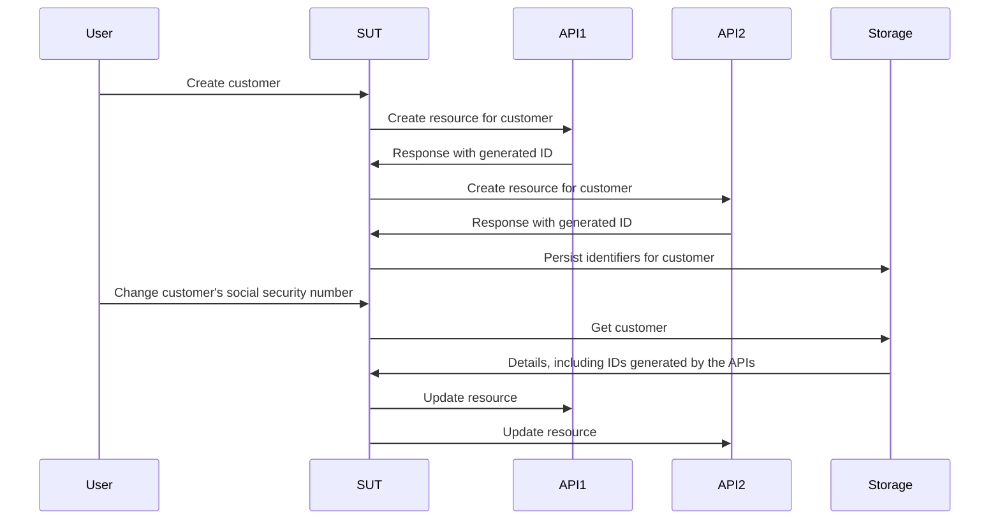

# العمل دون بدائل وهمية وبدائل ثابتة وجواسيس

يغوص هذا الفصل في عالم بدائل الاختبار (test doubles) ويستكشف كيف تؤثر في عملية الاختبار والتطوير. وسنكشف حدود البدائل الوهمية (mocks) والبدائل الثابتة (stubs) والجواسيس (spies) التقليدية، ونقدّم أسلوباً أكثر كفاءة وقابلية للتكيف باستعمال البدائل المزيفة (fakes) والعقود.

## باختصار

- تشجعك البدائل الوهمية والجواسيس والبدائل الثابتة على ترميز افتراضاتك عن سلوك تبعياتك بشكل مرتجل في كل اختبار.
- لا يُتحقق عادةً من هذه الافتراضات إلا بالفحص اليدوي، لذا فهي تهدد فائدة مجموعة اختباراتك.
- تمنحنا البدائل المزيفة والعقود طريقة أكثر استدامة لإنشاء بدائل الاختبار، بافتراضات متحقق منها وإعادة استعمال أفضل من البدائل الأخرى.

هذا الفصل أطول من المعتاد، لذا وكمنعش للذهن، ينبغي أن تستكشف [المستودع النموذجي أولاً](https://github.com/quii/go-fakes-and-contracts). وتحديداً، اطّلع على [اختبار المخطِّط](https://github.com/quii/go-fakes-and-contracts/blob/main/domain/planner/planner_test.go).

---

تعلّمنا في فصل [المحاكاة](https://quii.gitbook.io/learn-go-with-tests/go-fundamentals/mocking) كيف أن البدائل الوهمية والبدائل الثابتة والجواسيس أدوات مفيدة للتحكم بسلوك وحدات الشيفرة (code) وفحصه، بالاقتران مع [حقن التبعية](https://quii.gitbook.io/learn-go-with-tests/go-fundamentals/dependency-injection).

لكن مع نمو المشروع، *قد* تصبح هذه الأنواع من بدائل الاختبار عبئاً في الصيانة، وينبغي أن نتطلع بدلاً من ذلك إلى أفكار تصميمية أخرى تُبقي نظامنا سهل الفهم والاختبار.

تتيح **البدائل المزيفة** و**العقود** للمطورين اختبار أنظمتهم بسيناريوهات أكثر واقعية، وتحسين تجربة التطوير المحلي بحلقات تغذية راجعة أسرع وأدق، وإدارة تعقيد التبعيات المتطورة.

### تمهيد عن بدائل الاختبار

من السهل أن تتبرم حين يتحذلق أمثالي في تسميات بدائل الاختبار، لكن الأنواع المميزة من بدائل الاختبار تساعدنا على الحديث عن هذا الموضوع وعن المقايضات التي نقوم بها بوضوح.

**بدائل الاختبار** هو الاسم الجامع للطرق المختلفة التي يمكنك بها بناء تبعيات تتحكم بها لـ**الشيء قيد الاختبار** **(SUT)**، أي ما تختبره. وكثيراً ما تكون بدائل الاختبار بديلاً أفضل من استعمال التبعية الحقيقية، لأنها تتجنب مشكلات مثل

- الحاجة إلى الإنترنت لاستعمال واجهة برمجية
- تجنب زمن الاستجابة ومشكلات الأداء الأخرى
- العجز عن اختبار الحالات خارج المسار الناجح
- فك اقتران عملية البناء لديك بعملية بناء فريق آخر.
  - فلا تريد أن تمنع عمليات النشر إن أطلق مهندس في فريق آخر خطأً برمجياً عن غير قصد

في غو (Go)، ستنمذج التبعية عادةً بواجهة (interface)، ثم تنفّذ نسختك للتحكم بالسلوك في الاختبار. **إليك أنواع بدائل الاختبار التي يتناولها هذا الفصل**.

بمعلومية هذه الواجهة لواجهة برمجية افتراضية للوصفات:

```go
type RecipeBook interface {
	GetRecipes() ([]Recipe, error)
	AddRecipes(...Recipe) error
}
```

يمكننا بناء بدائل الاختبار بطرق مختلفة، بحسب الطريقة التي نحاول بها اختبار شيء يستعمل `RecipeBook`.

**البدائل الثابتة** تعيد البيانات الجاهزة نفسها في كل مرة تُستدعى

```go
type StubRecipeStore struct {
	recipes []Recipe
	err     error
}

func (s *StubRecipeStore) GetRecipes() ([]Recipe, error) {
	return s.recipes, s.err
}

// AddRecipes omitted for brevity
```

```go
// in test, we can set up the stub to always return specific recipes, or an error
stubStore := &StubRecipeStore{
	recipes: someRecipes,
}
```

**الجواسيس** تشبه البدائل الثابتة، لكنها تسجّل أيضاً كيف استُدعيت، كي يستطيع الاختبار التوكيد على أن الشيء قيد الاختبار يستدعي التبعيات بطرق محددة.

```go
type SpyRecipeStore struct {
	AddCalls [][]Recipe
	err      error
}

func (s *SpyRecipeStore) AddRecipes(r ...Recipe) error {
	s.AddCalls = append(s.AddCalls, r)
	return s.err
}

// GetRecipes omitted for brevity
```

```go
// in test
spyStore := &SpyRecipeStore{}
sut := NewThing(spyStore)
sut.DoStuff()

// now we can check the store had the right recipes added by inspectiong spyStore.AddCalls
```

**البدائل الوهمية** أشبه بمجموعة شاملة لما سبق، لكنها لا تستجيب ببيانات محددة إلا لاستدعاءات محددة. فإن استدعى الشيء قيد الاختبار التبعيات بوسطاء خاطئة، فستُطلق الذعر عادةً.

```go
// set up the mock with expected calls
mockStore := &MockRecipeStore{}
mockStore.WhenCalledWith(someRecipes).Return(someError)

// when the sut uses the dependency, if it doesn't call it with someRecipes, usually mocks will panic
```

**البدائل المزيفة** أشبه بنسخة حقيقية من التبعية، لكنها منفذة بطريقة أنسب للاختبارات السريعة الموثوقة وللتطوير المحلي. فكثيراً ما يكون في نظامك تجريد ما حول التخزين الدائم، يُنفَّذ بقاعدة بيانات، لكن في اختباراتك يمكنك استعمال بديل مزيف في الذاكرة بدلاً منها.

```go
type FakeRecipeStore struct {
	recipes []Recipe
}

func (f *FakeRecipeStore) GetRecipes() ([]Recipe, error) {
	return f.recipes, nil
}

func (f *FakeRecipeStore) AddRecipes(r ...Recipe) error {
	f.recipes = append(f.recipes, r...)
	return nil
}
```

البدائل المزيفة مفيدة لأن:

- احتفاظها بالحالة مفيد للاختبارات التي تشمل عدة أشياء قيد الاختبار واستدعاءات متعددة، مثل اختبار التكامل. أما إدارة الحالة مع الأنواع الأخرى من بدائل الاختبار فلا يُنصح بها عموماً.
- إن كانت لها واجهة برمجية معقولة، فإنها توفر طريقة أكثر طبيعية للتوكيد على الحالة. فبدلاً من التجسس على استدعاءات محددة لتبعية ما، يمكنك الاستعلام عن حالتها النهائية لترى إن كان الأثر الحقيقي الذي تريده قد حدث.
- يمكنك استعمالها لتشغيل تطبيقك محلياً دون تشغيل تبعيات حقيقية أو الاعتماد عليها. وهذا يحسّن عادةً تجربة المطورين (DX)، لأن البدائل المزيفة ستكون أسرع وأكثر موثوقية من نظيراتها الحقيقية.

يمكن عادةً توليد الجواسيس والبدائل الوهمية والبدائل الثابتة تلقائياً من واجهة باستعمال أداة أو باستعمال الانعكاس. أما البدائل المزيفة، فلأنها ترمّز سلوك التبعية التي تحاول صنع بديل لها، فستضطر إلى كتابة معظم التنفيذ بنفسك على الأقل

## المشكلة في البدائل الثابتة والبدائل الوهمية

في فصل [الأنماط المضادة](https://quii.gitbook.io/learn-go-with-tests/meta/anti-patterns) تفاصيل عن ضرورة استعمال بدائل الاختبار بحذر. فإنشاء مجموعة اختبارات فوضوية سهل إن لم تستعملها بذوق. لكن مع نمو المشروع، قد تتسلل مشكلات أخرى.

حين ترمّز السلوك في بدائل الاختبار، فإنك تضيف إلى الاختبار افتراضاتك عن طريقة عمل التبعية الحقيقية. فإن كان هناك تباين بين سلوك البديل والتبعية الحقيقية، أو إن حدث تباين مع الوقت (كأن تتغير التبعية الحقيقية، وهو أمر *يجب* توقعه)، **فقد تكون لديك اختبارات ناجحة لكن برمجيات فاشلة**.

وتمثّل البدائل الثابتة والجواسيس والبدائل الوهمية تحديداً تحديات أخرى، خصوصاً مع نمو المشروع. ولتوضيح ذلك، سأصف مشروعاً عملت عليه.

### دراسة حالة نموذجية

*غُيّرت بعض التفاصيل عما حدث فعلاً، وبُسّطت كثيراً اختصاراً. **وأي تشابه مع أشخاص حقيقيين، أحياء أو أموات، هو محض مصادفة.***

عملت على نظام كان عليه أن يستدعي **ست** واجهات برمجية مختلفة، كتبتها وتصونها فرق أخرى حول العالم. كانت _أشبه بـREST_، وكانت مهمة نظامنا إنشاء الموارد فيها كلها وإدارتها. وحين نستدعي كل الواجهات البرمجية بشكل صحيح لكل نظام، كان _السحر_ (قيمة الأعمال) يحدث.

كان تطبيقنا مبنياً على معمارية سداسية، أي معمارية المنافذ والمحوّلات. وكانت شيفرة مجالنا منفصلة عن فوضى العالم الخارجي الذي كان علينا التعامل معه. وكانت "محوّلاتنا" في الواقع عملاء غو يغلّفون استدعاء الواجهات البرمجية المختلفة.


#### المتاعب

بطبيعة الحال، اتبعنا أسلوباً مقاداً بالاختبارات في بناء النظام. فاستفدنا من البدائل الثابتة لمحاكاة استجابات الواجهات البرمجية في المراحل التالية، وكان لدينا عدد قليل من اختبارات القبول لنطمئن إلى أن كل شيء ينبغي أن يعمل.

لكن الواجهات البرمجية التي كان علينا استدعاؤها كانت في معظمها:

- رديئة التوثيق
- تديرها فرق لديها كثير من الأولويات والضغوط المتضاربة الأخرى، لذا لم يكن سهلاً الحصول على وقت معها
- كثيراً ما تفتقر إلى تغطية الاختبارات، لذا كانت تتعطل بطرق مسلية وغير متوقعة، وتتراجع، وغير ذلك
- كانت ما زالت قيد البناء والتطور

أدى هذا إلى **كثير من الاختبارات المتقلبة** وكثير من الصداع. وقضينا قدراً _كبيراً_ من وقتنا في مراسلة كثير من المشغولين على Slack محاولين الحصول على إجابات عن:

- لماذا بدأت الواجهة البرمجية بفعل `x`؟
- لماذا تفعل الواجهة البرمجية شيئاً مختلفاً حين نفعل `y`؟

نادراً ما يكون تطوير البرمجيات مباشراً كما تأمل؛ إنه تمرين في التعلم. فقد كان علينا أن نتعلم باستمرار كيف تعمل الواجهات البرمجية الخارجية. ومع تعلمنا وتكيفنا، كان علينا تحديث مجموعة اختباراتنا والإضافة إليها، وتحديداً **تغيير بدائلنا الثابتة لتطابق السلوك الفعلي للواجهات البرمجية.**

المشكلة أن هذا استهلك كثيراً من وقتنا وأدى إلى مزيد من الأخطاء. فحين تتغير معرفتك بتبعية ما، عليك إيجاد الاختبار **الصحيح** لتحديثه لتغيير سلوك البديل الثابت، وهناك خطر حقيقي في إهمال تحديثه في بدائل ثابتة أخرى تمثل التبعية نفسها.

#### استراتيجية الاختبار

فوق ذلك، ومع نمو النظام وتغير المتطلبات، أدركنا أن استراتيجية اختبارنا غير مناسبة. فقد كان لدينا عدد قليل من اختبارات القبول التي تمنحنا الثقة بأن النظام ككل يعمل، ثم عدد كبير من اختبارات الوحدة للحزم المختلفة التي كتبناها.

<u>كنا نحتاج إلى شيء بين الاثنين</u>؛ فكثيراً ما أردنا تغيير سلوك أجزاء مختلفة من النظام معاً **دون أن نضطر إلى تشغيل النظام *كله* لاختبار قبول**. واختبارات الوحدة وحدها لم تمنحنا الثقة بأن المكونات المختلفة تعمل ككل؛ فلم تستطع أن تروي (وتتحقق من) قصة ما نحاول تحقيقه. **كنا نريد اختبارات التكامل**.

#### اختبارات التكامل

تثبت اختبارات التكامل (integration tests) أن "وحدتين" أو أكثر تعملان بشكل صحيح حين تُجمعان (أو تتكاملان!). ويمكن أن تكون هذه الوحدات الشيفرة التي تكتبها، أو الشيفرة التي تكتبها متكاملة مع شيفرة شخص آخر، كقاعدة بيانات.

ومع نمو المشروع، ستريد كتابة مزيد من اختبارات التكامل لإثبات أن أجزاء كبيرة من نظامك "تتماسك معاً"، أي تتكامل!

قد تُغرى بكتابة مزيد من اختبارات القبول من نوع الصندوق الأسود، لكنها تصبح مكلفة بسرعة من حيث وقت البناء وتكاليف الصيانة. فقد يكون تشغيل نظام كامل مكلفاً جداً حين تريد فقط التحقق من أن *جزءاً* من النظام (لكن ليس وحدة واحدة فقط) يتصرف كما ينبغي. وكتابة اختبارات صندوق أسود مكلفة لكل جزء من الوظائف التي تكتبها ليست مستدامة للأنظمة الأكبر.

#### الحل: البدائل المزيفة

كانت المشكلة أن طريقة اختبار وحداتنا تعتمد على البدائل الثابتة، وهي في معظمها *لا تحتفظ بالحالة*. وكنا نريد كتابة اختبارات تغطي استدعاءات متعددة للواجهات البرمجية *تحتفظ بالحالة*، كأن ننشئ مورداً في البداية ثم نعدّله لاحقاً.

ما يلي نسخة مختصرة من اختبار نريد كتابته.

الشيء قيد الاختبار "طبقة خدمات" تتعامل مع طلبات "حالات الاستعمال". ونريد أن نثبت أنه إن أُنشئ عميل، فحين تتغير تفاصيله، نحدّث بنجاح الموارد التي أنشأناها في الواجهات البرمجية المعنية.

إليك المتطلبات التي أُعطيت للفريق على شكل قصة مستخدم.

> ***بمعلومية*** أن المستخدم مسجّل في الواجهات البرمجية 1 و2 و3
>
> ***عندما*** يتغير رقم الضمان الاجتماعي للعميل
>
> ***عندئذٍ*** ينتشر التغيير إلى الواجهات البرمجية 1 و2 و3



الاختبارات التي تمتد عبر عدة وحدات لا تتوافق عادةً مع البدائل الثابتة، **لأنها غير مناسبة للاحتفاظ بالحالة**. كان _بإمكاننا_ كتابة اختبار قبول من نوع الصندوق الأسود، لكن تكاليف هذه الاختبارات ستخرج عن السيطرة بسرعة.

إضافة إلى ذلك، اختبار الحالات الحدّية باختبار صندوق أسود معقد، لأنك لا تستطيع التحكم بالتبعيات. فمثلاً، أردنا أن نثبت أن آلية تراجع ستُطلق إن فشل استدعاء لإحدى الواجهات البرمجية.

كنا نحتاج إلى استعمال **البدائل المزيفة**. فبنمذجة تبعياتنا كواجهات برمجية تحتفظ بالحالة ببدائل مزيفة في الذاكرة، استطعنا كتابة اختبارات تكامل بنطاق أوسع بكثير، **تتيح لنا اختبار أن حالات الاستعمال الحقيقية تعمل**، مرة أخرى *دون* الاضطرار إلى تشغيل النظام كله، وبسرعة تكاد تساوي سرعة اختبارات الوحدة.


باستعمال البدائل المزيفة، **يمكننا إجراء توكيدات مبنية على الحالات النهائية للأنظمة المعنية بدلاً من الاعتماد على تجسس معقد**. فكنا نسأل كل بديل مزيف عن السجلات التي يحتفظ بها للعميل، ونؤكد أنها حُدّثت. وهذا يبدو أكثر طبيعية؛ فلو كنا نتحقق من نظامنا يدوياً، لاستعلمنا من تلك الواجهات البرمجية للتحقق من حالتها، لا أن نفحص سجلات طلباتنا لنرى إن كنا أرسلنا حمولات JSON معيّنة.

```go
// take our lego-bricks and assemble the system for the test
fakeAPI1 := fakes.NewAPI1()
fakeAPI2 := fakes.NewAPI2() // etc..
customerService := customer.NewService(fakeAPI1, fakeAPI2, etc...)

// create new customer
newCustomerRequest := NewCustomerReq{
	// ...
}
createdCustomer, err := customerService.New(newCustomerRequest)
assert.NoErr(t, err)

// we can verify all the details are as expected in the various fakes in a natural way, as if they're normal APIs
fakeAPI1Customer := fakeAPI1.Get(createdCustomer.FakeAPI1Details.ID)
assert.Equal(t, fakeAPI1Customer.SocialSecurityNumber, newCustomerRequest.SocialSecurityNumber)

// repeat for the other apis we care about

// update customer
updatedCustomerRequest := NewUpdateReq{SocialSecurityNumber: "123", InternalID: createdCustomer.InternalID}
assert.NoErr(t, customerService.Update(updatedCustomerRequest))

// again we can check the various fakes to see if the state ends up how we want it
updatedFakeAPICustomer := fakeAPI1.Get(createdCustomer.FakeAPI1Details.ID)
assert.Equal(t, updatedFakeAPICustomer.SocialSecurityNumber, updatedCustomerRequest.SocialSecurityNumber)
```

هذا أبسط في الكتابة وأسهل في القراءة من التحقق من وسطاء استدعاءات دوال مختلفة عبر الجواسيس.

يتيح لنا هذا الأسلوب كتابة اختبارات تمتد عبر أجزاء واسعة من نظامنا، فنكتب اختبارات **ذات معنى** أكبر عن حالات الاستعمال التي كنا نناقشها في الاجتماع اليومي، مع بقائها سريعة التنفيذ للغاية.

#### البدائل المزيفة تجلب مزيداً من فوائد التغليف

في المثال أعلاه، لم تكن الاختبارات تهتم بكيفية تصرف التبعيات أبعد من التحقق من حالتها النهائية. فقد أنشأنا النسخ المزيفة من التبعيات وحقنّاها في جزء النظام الذي نختبره.

أما مع البدائل الوهمية أو الثابتة، فسيكون علينا إعداد كل تبعية لمعالجة سيناريوهات معيّنة، وإعادة بيانات معيّنة، وغير ذلك. وهذا يُدخل السلوك وتفاصيل التنفيذ إلى اختباراتك، فيضعف فوائد التغليف (encapsulation).

نحن ننمذج التبعيات خلف واجهات كي لا _نضطر كعملاء إلى الاهتمام بطريقة عملها_، لكن مع أسلوب "أنصار البدائل الوهمية" _علينا أن نهتم **في كل اختبار**_.

#### تكاليف صيانة البدائل المزيفة

البدائل المزيفة أكثر كلفة من بدائل الاختبار الأخرى، على الأقل من حيث الشيفرة المكتوبة؛ فعليها أن تحتفظ بالحالة وتحاكي سلوك أي شيء تزيّفه. وأي تباين في السلوك بين بديلك المزيف والشيء الحقيقي **يحمل خطر** أن اختباراتك لا تتماشى مع الواقع. وهذا يقود إلى سيناريو تكون فيه لديك اختبارات ناجحة لكن برمجيات معطلة.

كلما تكاملت مع نظام آخر، سواء كان واجهة برمجية لفريق آخر أو قاعدة بيانات، ستضع افتراضات مبنية على سلوكه. وقد تأتي هذه من توثيق الواجهة البرمجية، أو محادثات مباشرة، أو رسائل بريد إلكتروني، أو سلاسل نقاش على Slack، وغير ذلك.

ألن يكون مفيداً لو استطعنا **ترميز افتراضاتنا** وتشغيلها على بديلنا المزيف *وعلى* النظام الفعلي معاً، لنرى إن كانت معرفتنا صحيحة، بطريقة قابلة للتكرار وموثّقة؟

**العقود** هي الوسيلة إلى هذه الغاية. فقد ساعدتنا على إدارة الافتراضات التي وضعناها عن أنظمة الفريق الآخر وجعلها صريحة. أكثر صراحة وفائدة بكثير من تبادل رسائل البريد الإلكتروني أو سلاسل Slack التي لا تنتهي!


بوجود عقد، يمكننا افتراض أننا نستطيع استعمال البديل المزيف والتبعية الفعلية بالتبادل. وهذا ليس مفيداً لبناء الاختبارات فحسب، بل للتطوير المحلي أيضاً.

إليك مثالاً على عقد لإحدى الواجهات البرمجية التي يعتمد عليها النظام

```go
type API1Customer struct {
	Name string
	ID   string
}

type API1 interface {
	CreateCustomer(ctx context.Context, name string) (API1Customer, error)
	GetCustomer(ctx context.Context, id string) (API1Customer, error)
	UpdateCustomer(ctx context.Context, id string, name string) error
}

type API1Contract struct {
	NewAPI1 func() API1
}

func (c API1Contract) Test(t *testing.T) {
	t.Run("can create, get and update a customer", func(t *testing.T) {
		var (
			ctx  = context.Background()
			sut  = c.NewAPI1()
			name = "Bob"
		)

		customer, err := sut.CreateCustomer(ctx, name)
		expect.NoErr(t, err)

		got, err := sut.GetCustomer(ctx, customer.ID)
		expect.NoErr(t, err)
		expect.Equal(t, customer, got)

		newName := "Robert"
		expect.NoErr(t, sut.UpdateCustomer(ctx, customer.ID, newName))

		got, err = sut.GetCustomer(ctx, customer.ID)
		expect.NoErr(t, err)
		expect.Equal(t, newName, got.Name)
	})

	// example of strange behaviours we didn't expect
	t.Run("the system will not allow you to add 'Dave' as a customer", func(t *testing.T) {
		var (
			ctx  = context.Background()
			sut  = c.NewAPI1()
			name = "Dave"
		)

		_, err := sut.CreateCustomer(ctx, name)
		expect.Err(t, ErrDaveIsForbidden)
	})
}
```

كما ناقشنا في فصل [توسيع اختبارات القبول](https://quii.gitbook.io/learn-go-with-tests/testing-fundamentals/scaling-acceptance-tests)، بالاختبار على واجهة بدلاً من نوع ملموس، يصبح الاختبار:

- منفصلاً عن تفاصيل التنفيذ
- قابلاً لإعادة الاستعمال في سياقات مختلفة.

وهذان هما متطلبا العقد. فهو يتيح لنا التحقق من بديلنا المزيف وتطويره، _و_ اختباره على التنفيذ الفعلي.

لإنشاء بديلنا المزيف في الذاكرة، يمكننا استعمال العقد في اختبار.

```go
func TestInMemoryAPI1(t *testing.T) {
	API1Contract{NewAPI1: func() API1 {
		return inmemory.NewAPI1()
	}}.Test(t)
}
```

وإليك شيفرة البديل المزيف

```go
func NewAPI1() *API1 {
	return &API1{customers: make(map[string]planner.API1Customer)}
}

type API1 struct {
	i         int
	customers map[string]planner.API1Customer
}

func (a *API1) CreateCustomer(ctx context.Context, name string) (planner.API1Customer, error) {
	if name == "Dave" {
		return planner.API1Customer{}, ErrDaveIsForbidden
	}

	newCustomer := planner.API1Customer{
		Name: name,
		ID:   strconv.Itoa(a.i),
	}
	a.customers[newCustomer.ID] = newCustomer
	a.i++
	return newCustomer, nil
}

func (a *API1) GetCustomer(ctx context.Context, id string) (planner.API1Customer, error) {
	return a.customers[id], nil
}

func (a *API1) UpdateCustomer(ctx context.Context, id string, name string) error {
	customer := a.customers[id]
	customer.Name = name
	a.customers[id] = customer
	return nil
}
```

### البرمجيات المتطورة

معظم البرمجيات لا تُبنى و"تُنجز" إلى الأبد في إصدار واحد.

إنها تمرين تدريجي في التعلم، يتكيف مع مطالب العملاء والتغييرات الخارجية الأخرى. ففي المثال، كانت الواجهات البرمجية التي نستدعيها تتطور وتتغير أيضاً؛ وفوق ذلك، ومع تطويرنا لبرمجياتـ_نا_، تعلّمنا المزيد عن النظام الذي نحتاج _حقاً_ إلى صنعه. فتبيّن أن افتراضات وضعناها في عقودنا خاطئة، أو _أصبحت_ خاطئة.

لحسن الحظ، بمجرد أن أُعدّت العقود، صارت لدينا طريقة بسيطة للتعامل مع التغيير. فبمجرد أن نتعلم شيئاً جديداً، نتيجة إصلاح خطأ برمجي أو إبلاغ زميل لنا بأن الواجهة البرمجية تتغير، كنا:

1. نكتب اختباراً للسيناريو الجديد. وجزء من هذا سيتضمن تغيير العقد لـ**يقودك** إلى محاكاة السلوك في البديل المزيف
2. ينبغي أن يفشل تشغيل الاختبار، لكن قبل أي شيء آخر، شغّل العقد على التبعية الحقيقية للتأكد من أن التغيير في العقد صحيح.
3. حدّث البديل المزيف ليتوافق مع العقد.
4. اجعل الاختبار ينجح.
5. أعد الهيكلة.
6. شغّل كل الاختبارات وأطلق.

تشغيل مجموعة الاختبارات _كاملة_ قبل الإيداع _قد_ يؤدي إلى فشل اختبارات أخرى بسبب اختلاف سلوك البديل المزيف. وهذا **أمر جيد**!  فيمكنك الآن إصلاح كل المناطق الأخرى من النظام التي تعتمد على النظام الذي تغيّر، واثقاً من أنها ستتعامل أيضاً مع هذا السيناريو في بيئة الإنتاج. ودون هذا الأسلوب، كان عليك أن *تتذكر* إيجاد كل الاختبارات ذات الصلة وتحديث البدائل الثابتة. وهذا عرضة للأخطاء، ومجهد، وممل.

### تجربة مطورين متفوقة

امتلاك مجموعة البدائل المزيفة مع العقود المقابلة لها بدا كقوة خارقة. فقد استطعنا أخيراً ترويض تعقيد الواجهات البرمجية التي كان علينا التعامل معها.

صارت كتابة الاختبارات لسيناريوهات مختلفة أبسط بكثير. فلم نعد مضطرين إلى تجميع سلسلة من البدائل الثابتة والجواسيس لكل اختبار؛ بل صار بإمكاننا أخذ مجموعة وحداتنا أو وحداتنا النمطية (البدائل المزيفة، و"خدماتنا" الخاصة) وتجميعها بسهولة كبيرة لاختبار السيناريوهات الغريبة والعجيبة المختلفة التي نحتاج إليها.

كل اختبار فيه بديل ثابت أو جاسوس أو بديل وهمي عليه أن _يهتم_ بكيفية تصرف النظام الخارجي، بسبب الإعداد المرتجل. أما البدائل المزيفة فيمكن معاملتها كأي وحدة شيفرة أخرى جيدة التغليف، تُخفى عنك تفاصيلها، وتستطيع استعمالها فحسب.

كنا نستطيع تشغيل نسخة واقعية جداً من النظام محلياً، ولأن كل شيء كان في الذاكرة، كان يبدأ ويعمل بسرعة كبيرة جداً. وهذا يعني أن أزمنة اختباراتنا كانت سريعة للغاية، وهذا بدا مذهلاً جداً بالنظر إلى مدى شمول مجموعة الاختبارات.

وإن فشلت اختبارات القبول في بيئة التجهيز، كانت خطوتنا الأولى تشغيل عقودنا على الواجهات البرمجية التي نعتمد عليها. وكثيراً ما حددنا المشكلات **قبل أن يحددها مطورو الأنظمة الأخرى**.

### خارج المسار الناجح باستعمال المزخرِفات

في سيناريوهات الأخطاء، البدائل الثابتة أكثر ملاءمة لأن لديك وصولاً مباشراً إلى *كيفية* تصرفها في الاختبار، بينما تميل البدائل المزيفة إلى أن تكون صندوقاً أسود إلى حد ما. وهذا قرار تصميمي مقصود، لأننا نريد ألا يهتم مستعملوها (كالاختبارات) بطريقة عملها؛ بل ينبغي أن يثقوا بأنها تفعل الصواب بفضل دعم العقد.

كيف نجعل البدائل المزيفة تفشل، لاختبار الاهتمامات خارج المسار الناجح؟

هناك سيناريوهات كثيرة تحتاج فيها كمطور إلى تعديل سلوك شيفرة ما دون تغيير مصدرها. و**نمط المزخرِف** كثيراً ما يكون وسيلة لأخذ وحدة شيفرة وإضافة أشياء مثل التسجيل والقياس عن بعد وإعادة المحاولة وغير ذلك. ويمكننا استعماله لتغليف بدائلنا المزيفة لتجاوز سلوكها عند الحاجة.

بالعودة إلى مثال `API1`، يمكننا إنشاء نوع (type) يحقق الواجهة المطلوبة ويغلّف البديل المزيف.

```go
type API1Decorator struct {
	delegate           API1
	CreateCustomerFunc func(ctx context.Context, name string) (API1Customer, error)
	GetCustomerFunc    func(ctx context.Context, id string) (API1Customer, error)
	UpdateCustomerFunc func(ctx context.Context, id string, name string) error
}

// assert API1Decorator implements API1
var _ API1 = &API1Decorator{}

func NewAPI1Decorator(delegate API1) *API1Decorator {
	return &API1Decorator{delegate: delegate}
}

func (a *API1Decorator) CreateCustomer(ctx context.Context, name string) (API1Customer, error) {
	if a.CreateCustomerFunc != nil {
		return a.CreateCustomerFunc(ctx, name)
	}
	return a.delegate.CreateCustomer(ctx, name)
}

func (a *API1Decorator) GetCustomer(ctx context.Context, id string) (API1Customer, error) {
	if a.GetCustomerFunc != nil {
		return a.GetCustomerFunc(ctx, id)
	}
	return a.delegate.GetCustomer(ctx, id)
}

func (a *API1Decorator) UpdateCustomer(ctx context.Context, id string, name string) error {
	if a.UpdateCustomerFunc != nil {
		return a.UpdateCustomerFunc(ctx, id, name)
	}
	return a.delegate.UpdateCustomer(ctx, id, name)
}
```

يمكننا بعد ذلك في اختباراتنا استعمال الحقل `XXXFunc` لتعديل سلوك بديل الاختبار، تماماً كما تفعل مع البدائل الثابتة أو الجواسيس أو البدائل الوهمية.

```go
failingAPI1 = NewAPI1Decorator(inmemory.NewAPI1())
failingAPI1.UpdateCustomerFunc = func(ctx context.Context, id string, name string) error {
	return errors.New("failed to update customer")
}
```

لكن هذا _محرج_ فعلاً، ويتطلب منك بعض التقدير. فبهذا الأسلوب تفقد الضمانات التي يوفرها العقد، لأنك تُدخل سلوكاً مرتجلاً إلى بديلك المزيف في الاختبارات.

من الأفضل أن تفحص سياقك، فقد تستنتج أن من الأبسط اختبار مسارات فشل محددة على مستوى اختبار الوحدة باستعمال بديل ثابت.

### أليست هذه الشيفرة الإضافية هدراً؟

من التمني الاعتقاد بأن علينا ألا نكتب إلا شيفرة تخدم العملاء، وأن نتوقع مع ذلك نظاماً نستطيع البناء عليه بكفاءة. فلدى الناس رأي مشوّه جداً عما يُعدّ هدراً (انظر تدوينتي: [شبح هنري فورد يدمّر فريق التطوير لديك](https://quii.dev/The_ghost_of_Henry_Ford_is_ruining_your_development_team)).

الاختبارات الآلية لا تفيد العملاء مباشرة، لكننا نكتبها لنجعل أنفسنا أكثر كفاءة في عملنا (فأنت لا تكتب الاختبارات لمطاردة نسب التغطية، أليس كذلك؟).

يجب أن يستطيع المهندسون محاكاة السيناريوهات بسهولة (بطريقة قابلة للتكرار، لا مرتجلة) لتنقيح المشكلات واختبارها وإصلاحها. **فالبدائل المزيفة في الذاكرة والتصميم المعياري الجيد يتيحان لنا عزل الأطراف ذات الصلة بسيناريو ما لكتابة اختبارات سريعة ومناسبة بتكلفة زهيدة للغاية**. وهذه المرونة تمكّن المطورين من التقدم في النظام بطريقة أسهل إدارة بكثير من فوضى متشابكة تُختبر عبر اختبارات صندوق أسود مكلفة الكتابة والتشغيل، أو ما هو أسوأ، عبر الاختبار اليدوي في بيئة مشتركة.

هذا مثال على [البسيط مقابل السهل](https://www.youtube.com/watch?v=SxdOUGdseq4). فبالطبع ستؤدي البدائل المزيفة والعقود إلى كتابة شيفرة أكثر من البدائل الثابتة والجواسيس على المدى القصير، لكن النتيجة نظام أكثر وضوحاً وأرخص صيانة على المدى الطويل. فتحديث الجواسيس والبدائل الثابتة والبدائل الوهمية قطعة قطعة مجهد وعرضة للأخطاء، لأنه لن تكون لديك عقود مقابلة للتحقق من أن بدائل اختبارك تتصرف بشكل صحيح.

يمثّل هذا الأسلوب تكلفة مبدئية أعلى _قليلاً_، لكن بتكاليف أقل بكثير بمجرد إعداد العقود والبدائل المزيفة. والبدائل المزيفة أكثر قابلية لإعادة الاستعمال وأكثر موثوقية من بدائل الاختبار المرتجلة مثل البدائل الثابتة.

يشعرك الأمر بتحرر *كبير* ويمنحك **الثقة** حين تستعمل بديلاً مزيفاً موجوداً ومجرّباً في المعارك، بدلاً من إعداد بديل ثابت عند كتابة اختبار جديد.

### كيف يتلاءم هذا مع `TDD`؟

لا أنصح بـ_البدء_ بعقد؛ فهذا تصميم من الأسفل إلى الأعلى، وأجد عموماً أنه يتطلب مني ذكاءً أكبر، وهناك خطر أن أُفرط في التفكير في متطلبات افتراضية.

يتوافق هذا الأسلوب مع "الأسلوب المقاد باختبارات القبول" كما نوقش في فصول سابقة، وفي [لماذا TDD](https://quii.dev/The_Why_of_TDD)، وفي كتاب [GOOS](http://www.growing-object-oriented-software.com)

- اكتب [اختبار قبول](https://quii.gitbook.io/learn-go-with-tests/testing-fundamentals/scaling-acceptance-tests) فاشلاً.
- استخلص ما يكفي من الشيفرة لجعله ينجح، وهذا يؤدي عادةً إلى "طبقة خدمات" ما تعتمد على واجهة برمجية أو قاعدة بيانات أو أي شيء آخر. وعادةً ستكون لديك شيفرة منطق أعمال منفصلة عن الاهتمامات الخارجية (كالتخزين الدائم، واستدعاء قاعدة بيانات، وغير ذلك) عبر واجهة.
- نفّذ الواجهة ببديل مزيف في الذاكرة أولاً لتجعل كل الاختبارات تنجح محلياً وتتحقق من التصميم الأولي.
- للدفع إلى بيئة الإنتاج، لا يمكنك استعمال الذاكرة! رمّز الافتراضات التي وضعتها على البديل المزيف في عقد.
- استعمل العقد لإنشاء التبعية الفعلية، كنسخة MySQL من مخزن ما.
- أطلق.

##  أين الفصل الخاص باختبار قواعد البيانات؟

هذا طلب شائع أجّلته لأكثر من خمس سنوات. والسبب أن هذا الفصل سيكون دائماً جوابي.

<u>لا تحاكِ مشغّل قاعدة البيانات ولا تتجسس على الاستدعاءات</u>. فهذه الاختبارات صعبة الكتابة، وقد تجلب قيمة ضئيلة جداً. ولا ينبغي أن تؤكد ما إذا كانت تعليمة `SQL` معيّنة قد أُرسلت إلى قاعدة البيانات، فهذا تفصيل من تفاصيل التنفيذ؛ **ينبغي ألا تهتم اختباراتك إلا بالسلوك**. فإثبات أن تعليمة SQL معيّنة قد صُرّفت _لا_ يثبت أن شيفرتك _تتصرف_ كما تحتاج إليها.

**العقود** تجبرك على فصل اختباراتك عن تفاصيل التنفيذ والتركيز على السلوك.

اتبع أسلوب `TDD` الموصوف أعلاه لاستخلاص احتياجاتك من التخزين الدائم.

في [المستودع النموذجي](https://github.com/quii/go-fakes-and-contracts) بعض الأمثلة على العقود، وكيف تُستعمل لاختبار تنفيذات في الذاكرة وبـSQLite لبعض احتياجات التخزين الدائم.

```go
package inmemory_test

import (
	"github.com/quii/go-fakes-and-contracts/adapters/driven/persistence/inmemory"
	"github.com/quii/go-fakes-and-contracts/domain/planner"
	"testing"
)

func TestInMemoryPantry(t *testing.T) {
	planner.PantryContract{
		NewPantry: func() planner.Pantry {
			return inmemory.NewPantry()
		},
	}.Test(t)
}
```

```go
package sqlite_test

import (
	"github.com/quii/go-fakes-and-contracts/adapters/driven/persistence/sqlite"
	"github.com/quii/go-fakes-and-contracts/domain/planner"
	"testing"
)

func TestSQLitePantry(t *testing.T) {
	client := sqlite.NewSQLiteClient()
	t.Cleanup(func() {
		if err := client.Close(); err != nil {
			t.Error(err)
		}
	})

	planner.PantryContract{
		NewPantry: func() planner.Pantry {
			return sqlite.NewPantry(client)
		},
	}.Test(t)
}
```

مع أن Docker وأمثاله _تجعل_ تشغيل قواعد البيانات محلياً أسهل، فما زالت قد تحمل عبئاً كبيراً على الأداء. والبدائل المزيفة مع العقود تتيح لك قصر الحاجة إلى استعمال التبعية "الأثقل" على وقت التحقق من العقد فقط، دون الحاجة إليها في الأنواع الأخرى من الاختبارات.

استعمال البدائل المزيفة في الذاكرة لاختبارات القبول والتكامل في *بقية* النظام يوفر تجربة مطورين أسرع وأبسط بكثير.

## الخلاصة

من الشائع أن تُنظَّم مشاريع البرمجيات بفرق مختلفة تبني أنظمة في الوقت نفسه محاولةً الوصول إلى هدف مشترك.

تتطلب طريقة العمل هذه درجة عالية من التعاون والتواصل. ويرى كثيرون أننا بأسلوب "الواجهة البرمجية أولاً" نستطيع تعريف بعض عقود الواجهات البرمجية (كثيراً ما تكون في صفحة ويكي!) ثم نعمل باستقلالية لستة أشهر ونجمع كل شيء معاً. ونادراً ما ينجح هذا عملياً، لأننا حين نبدأ بكتابة الشيفرة نفهم المجال والمشكلة بشكل أفضل، وهذا يتحدى افتراضاتنا. وعلينا أن نتفاعل مع هذه التغيرات في المعرفة، وهي كثيراً ما تتطلب تغييرات عبر الفرق.

لذا إن كنت في هذا الموقف، فعليك بناء نظامك واختباره بالطريقة المثلى للتعامل مع التغييرات غير المتوقعة، داخل النظام الذي تعمل عليه وخارجه.

> "من السمات المميزة للفرق عالية الأداء في تطوير البرمجيات قدرتها على التقدم وتغيير رأيها، دون طلب إذن من أي شخص أو مجموعة خارج فريقها الصغير."
>
> كتاب Modern Software Engineering
> ديفيد فارلي

لا تعتمد على الاجتماعات الأسبوعية أو سلاسل Slack لبلورة التغييرات. **رمّز افتراضاتك في عقود**. وشغّل تلك العقود على الأنظمة في خطوط البناء لديك، كي تحصل على تغذية راجعة سريعة إن ظهرت معلومات جديدة. وهذه العقود، بالاقتران مع **البدائل المزيفة**، تعني أنك تستطيع العمل باستقلالية وإدارة التغييرات الخارجية بشكل مستدام.

### نظامك كمجموعة من الوحدات النمطية

بالعودة إلى كتاب فارلي، فأنا أصف فكرة **التدرجية**. فبناء البرمجيات *تمرين مستمر في التعلم*. وفهم المتطلبات التي علينا حلها لنظام معيّن لتقديم القيمة مسبقاً أمر غير واقعي. لذا علينا تحسين أنظمتنا وطرق عملنا لـ**جمع التغذية الراجعة بسرعة والتجريب**.

تحتاج إلى **نظام معياري** للاستفادة من الأفكار التي نوقشت في هذا الفصل. فإن كانت لديك شيفرة معيارية مع بدائل مزيفة موثوقة، فهذا يتيح لك تجربة نظامك عبر الاختبارات الآلية بتكلفة زهيدة.

وجدنا أن من السهل للغاية ترجمة السيناريوهات الغريبة والافتراضية (لكن الممكنة) إلى اختبارات مكتفية بذاتها، تساعدنا على فهم المشكلة واستخلاص برمجيات أكثر متانة، بتركيب وحداتنا النمطية معاً وتجربة بيانات مختلفة بترتيب مختلف، مع فشل بعض الواجهات البرمجية، وغير ذلك.

الوحدات النمطية جيدة التعريف وجيدة الاختبار تتيح لك تطوير نظامك تدريجياً دون تغيير _كل شيء_ وفهمه دفعة واحدة.

### لكنني أعمل على شيء صغير بواجهات برمجية مستقرة

حتى مع الواجهات البرمجية المستقرة، لا تريد أن تكون تجربة المطورين وعمليات البناء وما إلى ذلك مقترنة بشدة بشيفرة الآخرين. وحين تتقن هذا الأسلوب، ينتهي بك الأمر إلى مجموعة من الوحدات النمطية القابلة للتركيب لتجميع نظامك للإنتاج، والتشغيل المحلي، وكتابة أنواع مختلفة من الاختبارات ببدائل تثق بها.

وهذا يتيح لك عزل أجزاء النظام التي تهمك، وكتابة اختبارات ذات معنى عن المشكلة الحقيقية التي تحاول حلها.

### اجعل تبعياتك مواطنين من الدرجة الأولى.

بالطبع للبدائل الثابتة والجواسيس مكانها. فمحاكاة السلوكيات المختلفة لتبعياتك بشكل مرتجل في الاختبارات سيكون لها دائماً استعمالها، لكن احرص على ألا تخرج التكاليف عن السيطرة.

رأيت مرات كثيرة في مسيرتي برمجيات مكتوبة بعناية من مطورين موهوبين تنهار بسبب مشكلات التكامل. فالتكامل صعب على المهندسين _لأن_ من الصعب إعادة إنتاج السلوك الدقيق لنظام كتبه مهندسون آخرون، يغيّرونه هم أيضاً في الوقت نفسه.

تعتمد بعض الفرق على أن ينشر الجميع إلى بيئة مشتركة ويختبروا هناك. والمشكلة أن هذا لا يعطيك تغذية راجعة **معزولة**، و**التغذية الراجعة بطيئة**. ولن تستطيع مع ذلك بناء تجارب مختلفة لطريقة عمل نظامك مع التبعيات الأخرى، على الأقل ليس بكفاءة.

**علينا ترويض هذا التعقيد بتبني طرق أكثر تطوراً لنمذجة تبعياتنا**، لنختبر ونجرّب بسرعة على أجهزة التطوير قبل أن يصل الأمر إلى الإنتاج. أنشئ بدائل مزيفة واقعية وسهلة الإدارة لتبعياتك، متحققاً منها بالعقود. وعندها يمكنك البدء بكتابة اختبارات أكثر معنى وتجربة نظامك، مما يجعلك أرجح نجاحاً.
